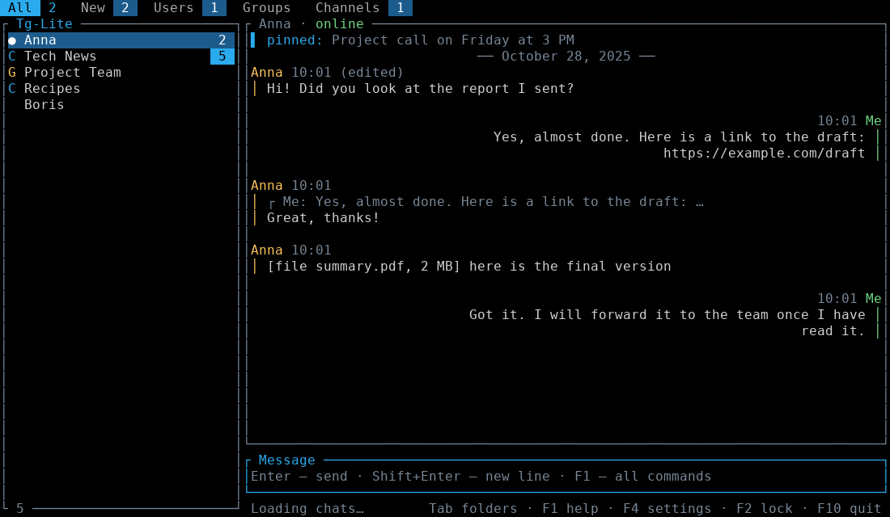
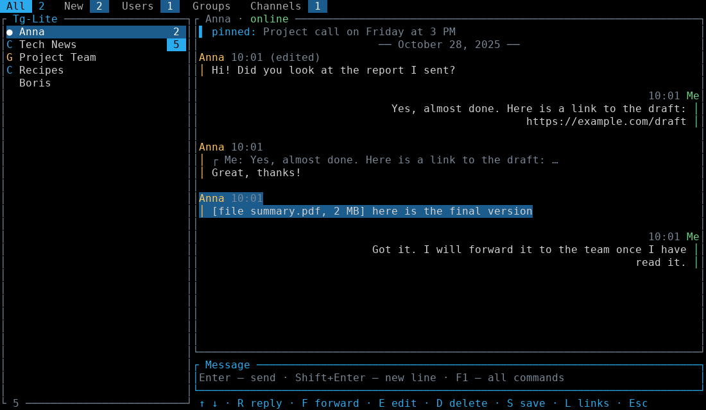
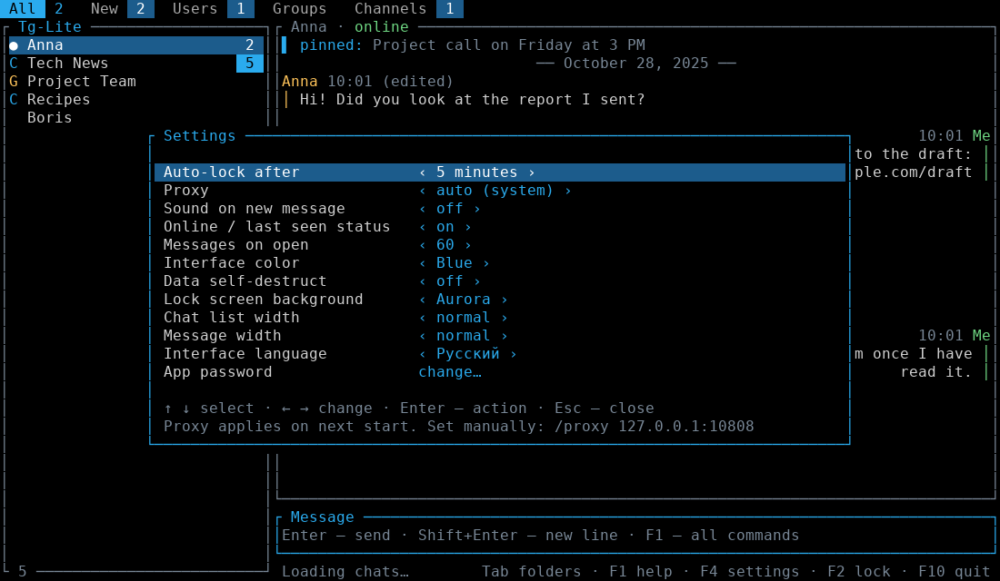
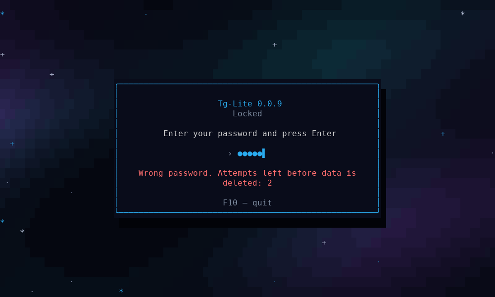
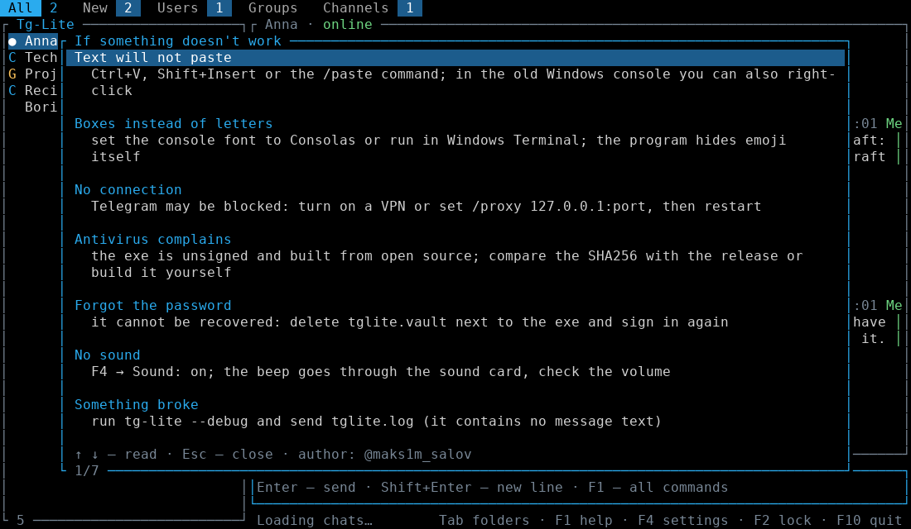
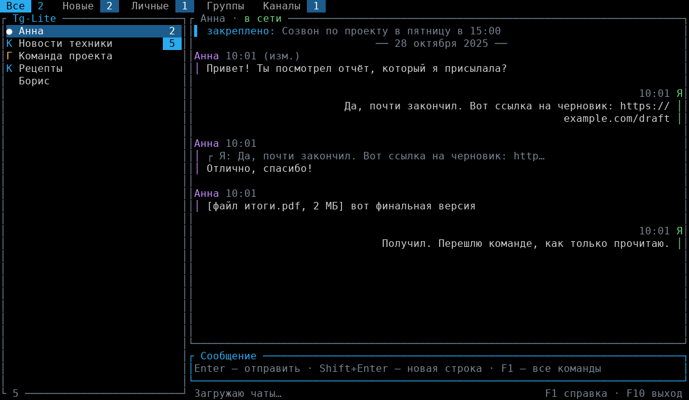
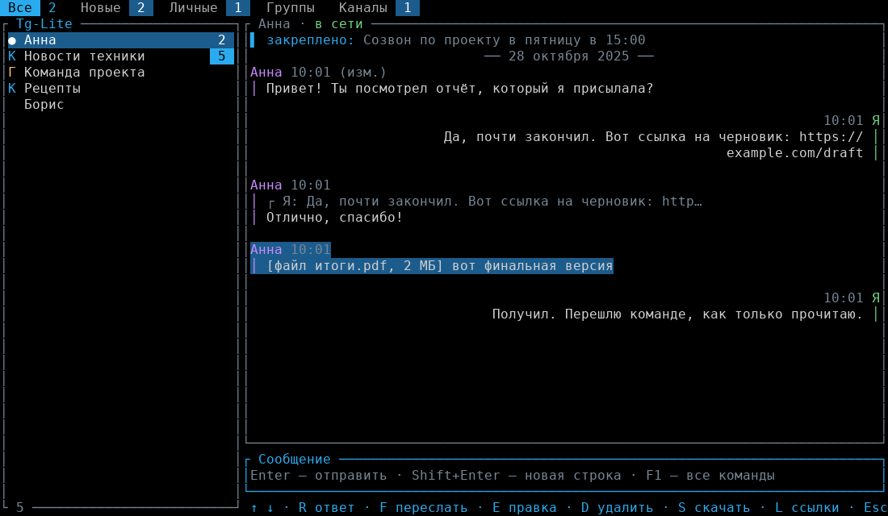
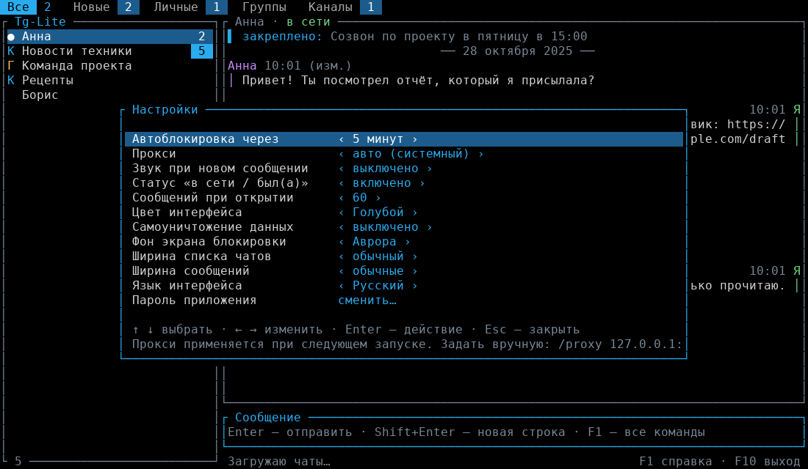
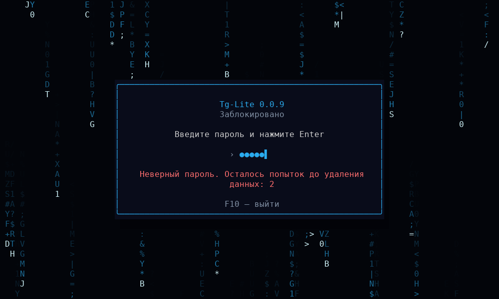
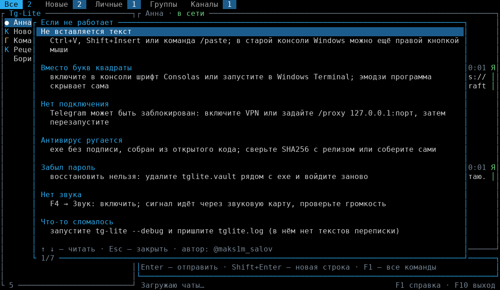

# Tg-Lite

**A tiny Telegram client for the terminal. One ~3.8 MB exe, about 3 MB of RAM.**

English · [Русский](#tg-lite-на-русском)

Tg-Lite is an unofficial Telegram client written in Rust for old and weak computers (it was built on a Pentium T4400
with 2 GB of RAM and a hard disk, where Telegram Desktop crawls). There is no Qt and no Electron: the interface is drawn
right in the console, and memory only holds what is on screen.

> Unofficial client. It speaks the open Telegram protocol (MTProto) through the
> [grammers](https://github.com/Lonami/grammers) library. You need your own `api_id` and `api_hash` from <https://my.telegram.org>.

## Contents
[Numbers](#numbers) · [Features](#features) · [Quick start](#quick-start) · [Keys and commands](#keys-and-commands) ·
[Security](#security) · [Proxy](#proxy) · [Build](#build) · [FAQ](#faq) · [Limits](#limits) · [Roadmap](#roadmap) · [License](#license)

## Numbers

Measured on a Lenovo B550 (Pentium T4400, 2 GB DDR2, HDD, Windows 10 LTSC):

| | Tg-Lite 0.0.8 | Telegram Desktop |
|---|---|---|
| RAM, chat screen right after start | **2.8 MB** | 800 MB and more¹ |
| RAM after 10–15 minutes of use | **2.8 MB** | up to 2–2.5 GB after long use¹ |
| RAM on the lock screen with the animated background | **2.9 MB** | – |
| CPU | ~0 % on the chat screen, 1.4–2 % while the animated lock screen is shown | depends on version and number of chats |
| Start to chat list | about 1 second | – |
| Size | one exe, **3.84 MB** (3934 KB) | tens of MB installed plus cache |
| Installation | none, put the exe in any folder | installer |

RAM is the "Memory (private working set)" column in Task Manager → Details. Other columns also count shared system
libraries and show more.

¹ Telegram Desktop figures are user reports, not lab measurements: [tdesktop #30151](https://github.com/telegramdesktop/tdesktop/issues/30151)
("starts use RAM up to 2.0-2.5gb", "less than 800mb" after a restart). The real value depends a lot on how many chats
and media you have open, so measure it on your own computer. Tg-Lite shows text only and does not decode photos or video,
which is the main reason it is so small.

## Features

**Chats**
- Sign in by phone number and code (plus your cloud password if you have one).
- Tabs: All, New (unread), Users, Groups, Channels and your own Telegram folders.
- Online / last seen (within the other person's privacy settings), unread counters, the unread total in the window title.
- Live updates: new, edited and deleted messages; "typing…" and "recording voice…" in the chat header; `@` marks mentions.
- A separate draft per chat; if sending fails the text returns to the input box.
- A pinned message is shown above the conversation.

**Messages**
- `F7` picks a message: reply with a quote (R), forward (F), edit (E), delete (D), save the attachment (S), links (L).
- `/edit`, `/del`, `/note` (quick note to Saved Messages), `/later 30 text` (schedule in 30 minutes), `/scheduled` (list and cancel).
- Markdown (`F3` or `/md`): `**bold**`, `_italic_`, `` `code` ``, `[link](https://…)`.
- Reply quotes, forwarded-from notes and "(edited)" marks. Photos, voice and files appear as labels such as `[photo]`, `[file report.pdf, 2 MB]`.

**Files and links**
- `/send path caption` uploads a file up to 2 GB (drag a file into the window to paste its path). jpg and png go as photos.
- `/save` downloads an attachment to the `downloads` folder next to the exe, with progress in the status bar.
- `/links` lists links of the chat, Enter opens one in the browser.

**Managing chats**
- `/find text` (`F6`, `Ctrl+F`) filters chats by name, `/pin` pins a chat, `/readall` marks everything read, `/export` saves a conversation to `export/<chat>.txt`.

**Comfort**
- Paste works: `Ctrl+V`, `Shift+Insert`, the terminal's own paste, or `/paste`.
- English and Russian interface (setting "Interface language", chosen at first start).
- Animated login and lock backgrounds: Aurora, Matrix, Stars (or none).
- Settings: auto-lock, proxy, sound, status, number of messages, accent color, widths, self-destruct, language, password.
- `/faq` shows troubleshooting tips inside the program. `tg-lite --debug` writes a detailed `tglite.log` (never message text).
- Emoji and invisible characters from other people's messages are hidden: the Windows console cannot draw them and the screen would fall apart.

<table>
<tr>
<td></td>
<td></td>
</tr>
<tr>
<td></td>
<td></td>
</tr>
</table>

## Quick start

1. Download `tg-lite.exe` from [Releases](../../releases) (or the CI artifact), and check it: `Get-FileHash tg-lite.exe -Algorithm SHA256` must match `tg-lite.exe.sha256`.
2. Run it, best from Windows Terminal or cmd with the Consolas font.
3. The first-run wizard has four steps:
   1. choose the language;
   2. enter `api_id` and `api_hash` (create an app at <https://my.telegram.org> → API development tools, then copy both values);
   3. choose an app password (any length, even one character);
   4. enter your phone number and the code from Telegram.
4. From then on only the password is asked.

`tglite.vault` is created next to the exe (change the folder with the `TGLITE_DIR` environment variable).
**A forgotten password cannot be recovered**: delete `tglite.vault` and sign in again.

## Keys and commands

Every action has both a key and a command, in case a key does not work in your console.

| Key | Command | Action |
|---|---|---|
| Enter | | send |
| Shift+Enter | | new line (pasted multi-line text is kept together) |
| Ctrl+V / Shift+Insert | `/paste` | paste from the clipboard |
| ↑ / ↓, Tab / Shift+Tab | | choose a chat, switch tabs |
| PgUp / PgDn | | scroll the conversation |
| Esc | | clear the input (empty input: reset search) |
| F1 | `/help` | help |
| F2 | `/lock` | lock |
| F3 | `/md` | Markdown on/off |
| F4 | `/settings` | settings |
| F5 | `/refresh` | refresh chat list |
| F6 | `/find text` | search chats |
| F7 | | pick a message: R reply, F forward, E edit, D delete, S save, L links |
| F10 | `/quit` | quit |
| | `/pin` `/readall` `/export` | pin chat, read everything, export |
| | `/edit` `/del` `/note` `/later` `/scheduled` | edit, delete, note, schedule, scheduled list |
| | `/send` `/save` `/links` | upload file, download attachment, links |
| | `/passwd` `/proxy` `/faq` | change password, proxy, troubleshooting |

`Ctrl+L`, `Ctrl+Q`, `Ctrl+T`, `Ctrl+R`, `Ctrl+F` also work, in any keyboard layout. `Alt+Enter` is not used (Windows gives it to full screen).

## Security

- `api_id`, `api_hash` and the Telegram session live in `tglite.vault`, encrypted with your password (Argon2id + ChaCha20-Poly1305). Without the password the file cannot be read and tampering is detected.
- The conversation is never written to disk. Exceptions are `/export` and `/save`, which you run yourself. Drafts live in memory only.
- Auto-lock after 1–60 minutes (or never) and on `F2`; the lock screen shows no messages.
- Optional self-destruct: delete the data after 3, 5 or 10 wrong passwords on the lock screen (off by default).
- The log never contains message text. The chosen language is stored in `tglite.lang` (not secret).

Details and how to report a vulnerability: [SECURITY.md](SECURITY.md).

## Proxy

Nothing needs to be typed. In "auto" mode the order is: manually set address, environment variables
(`ALL_PROXY`, `HTTPS_PROXY`), the Windows system proxy, then a direct connection. Plain HTTP proxies are handled by a
small local bridge the program starts itself. If nothing works it asks once for a SOCKS5 address (for example
`127.0.0.1:10808`) and remembers it. Manual: `/proxy 127.0.0.1:10808`, `/proxy auto`, `/proxy off` (applied on the next start).

## Build

Install Rust (<https://rustup.rs>), then `cargo build --release`; the exe appears in `target/release/tg-lite.exe`.
Checks: `cargo fmt --check`, `cargo clippy --all-targets -- -D warnings`, `cargo test`.

Without installing Rust: push the project to GitHub. **CI** (`.github/workflows/ci.yml`) runs fmt, clippy and tests on Linux, `cargo audit`,
and builds the Windows exe (Actions → the run → Artifacts; the job summary shows the size and SHA256).
**Releases:** push a tag such as `git tag v1.0.0 && git push --tags`, and `release.yml` publishes `tg-lite.exe` with `tg-lite.exe.sha256`.

**API keys in the build.** The secrets `TGLITE_API_ID` and `TGLITE_API_HASH` bake your keys into the exe so they need not be
typed. Do not do this in a public repository: anyone can download an exe with your keys.

## FAQ

The same list is available in the program as `/faq`.

| Problem | What to do |
|---|---|
| Text will not paste | `Ctrl+V`, `Shift+Insert` or `/paste`; in the old Windows console right-click also works |
| Boxes instead of letters | Use the Consolas font or Windows Terminal; the program hides emoji itself |
| No connection | Telegram may be blocked: use a VPN or `/proxy 127.0.0.1:port`, then restart |
| Antivirus complains | The exe is unsigned and built from open source; build it yourself or compare SHA256 with the release |
| Forgot the password | It cannot be recovered: delete `tglite.vault` and sign in again |
| No sound | `F4` → Sound: on; the beep goes through the sound card, check the volume |
| Anything else | Run `tg-lite --debug` and send `tglite.log` (no message text in it). Author: Telegram **@maks1m_salov** |

## Limits

- Text only: photos, voice, stickers and video are shown as labels (download with `/save` and open in another program). Emoji are hidden.
- No secret chats and no calls.
- Folders are built from the first 120 dialogs.
- The proxy mode is applied on the next start; the sign-in screen always uses the "Aurora" background (settings are inside the encrypted vault).
- Self-destruct works on the lock screen, not at the startup password prompt.
- If Telegram is blocked where you live you need a VPN or a proxy.
- Telegram is a trademark of its owners; this project is not affiliated with them.

## Roadmap

0.0.9 (this version) brings paste, English interface, first-run wizard, CI and releases. Next: more polish and testing on real
accounts, then **1.0**. Ideas that are not planned for 1.0: a graphical app with photos, video and voice, tray mode, a reusable core crate.

## License

[MIT](LICENSE) © @maks1m_salov. Issues and ideas: Telegram **@maks1m_salov**.

---

# Tg-Lite на русском

**Крошечный клиент Telegram для терминала. Один exe около 3,8 МБ, около 3 МБ памяти.**

[English](#tg-lite) · Русский

Tg-Lite — неофициальный клиент Telegram на Rust для старых и слабых компьютеров (он сделан на Pentium T4400 с 2 ГБ ОЗУ и
жёстким диском, где Telegram Desktop еле ворочается). Никакого Qt и Electron: интерфейс рисуется прямо в консоли, а в памяти
лежит только то, что нужно на экране.

> Неофициальный клиент. Использует открытый протокол Telegram (MTProto) через библиотеку
> [grammers](https://github.com/Lonami/grammers). Нужны ваши собственные `api_id` и `api_hash` с <https://my.telegram.org>.

## Содержание
[Цифры](#цифры) · [Возможности](#возможности) · [Быстрый старт](#быстрый-старт) · [Клавиши и команды](#клавиши-и-команды) ·
[Безопасность](#безопасность) · [Прокси](#прокси) · [Сборка](#сборка) · [Если не работает](#если-не-работает) · [Ограничения](#ограничения) ·
[Планы](#планы) · [Лицензия](#лицензия)

## Цифры

Замеры на Lenovo B550 (Pentium T4400, 2 ГБ DDR2, жёсткий диск, Windows 10 LTSC):

| | Tg-Lite 0.0.8 | Telegram Desktop |
|---|---|---|
| ОЗУ на экране чатов сразу после запуска | **2,8 МБ** | 800 МБ и больше¹ |
| ОЗУ через 10–15 минут работы | **2,8 МБ** | до 2–2,5 ГБ после долгой работы¹ |
| ОЗУ на экране блокировки с анимированным фоном | **2,9 МБ** | – |
| Процессор | ~0 % на экране чатов, 1,4–2 % пока показан анимированный экран блокировки | зависит от версии и числа чатов |
| От запуска до списка чатов | около секунды | – |
| Размер | один exe, **3,84 МБ** (3934 КБ) | десятки МБ установки плюс кэш |
| Установка | не нужна, exe кладётся в любую папку | установщик |

ОЗУ — столбец «Память (закрытый рабочий набор)» в Диспетчере задач → «Подробности». Другие столбцы учитывают и общие
системные библиотеки, поэтому показывают больше.

¹ Данные по Telegram Desktop — отзывы пользователей, а не лабораторные замеры: [tdesktop #30151](https://github.com/telegramdesktop/tdesktop/issues/30151)
(«starts use RAM up to 2.0-2.5gb», после перезапуска «less than 800mb»). Реальный расход сильно зависит от числа чатов и
открытых медиа, поэтому проверьте у себя. Tg-Lite показывает только текст и не раскодирует фото и видео — отсюда такой малый размер.

## Возможности

**Чаты**
- Вход по номеру телефона и коду (и облачному паролю Telegram, если он включён).
- Вкладки: Все, Новые (с непрочитанными), Личные, Группы, Каналы и ваши папки из Telegram.
- «В сети» / «был(а) в сети» (в пределах приватности собеседника), счётчики непрочитанных, число в заголовке окна.
- Всё приходит само: новые, изменённые и удалённые сообщения; «печатает…» и «записывает голосовое…» в заголовке; значок `@` у упоминаний.
- Свой черновик у каждого чата; если отправка не удалась, текст возвращается в поле ввода.
- Закреплённое сообщение показывается над перепиской.

**Сообщения**
- `F7` — выбрать сообщение: ответить с цитатой (R), переслать (F), править (E), удалить (D), скачать вложение (S), ссылки (L).
- `/edit`, `/del`, `/note` (быстрая заметка в «Избранное»), `/later 30 текст` (отложить на 30 минут), `/scheduled` (список и отмена).
- Markdown (`F3` или `/md`): `**жирный**`, `_курсив_`, `` `код` ``, `[ссылка](https://…)`.
- Цитаты ответов, пометки «переслано» и «(изм.)». Фото, голосовые и файлы показываются подписями: `[фото]`, `[файл отчёт.pdf, 2 МБ]`.

**Файлы и ссылки**
- `/send путь подпись` — отправить файл до 2 ГБ (путь можно просто перетащить в окно). Картинки jpg и png идут как фото.
- `/save` — скачать вложение в папку `downloads` рядом с exe, с прогрессом в строке состояния.
- `/links` — ссылки чата, Enter открывает ссылку в браузере.

**Управление чатами**
- `/find текст` (`F6`, `Ctrl+F`) — поиск по названиям, `/pin` — закрепить, `/readall` — всё прочитано, `/export` — сохранить переписку в `export/<чат>.txt`.

**Удобство**
- Вставка работает: `Ctrl+V`, `Shift+Insert`, вставка самого терминала или команда `/paste`.
- Интерфейс на русском и английском (настройка «Язык интерфейса», выбирается при первом запуске).
- Анимированный фон входа и блокировки: «Аврора», «Матрица», «Звёзды» или без анимации.
- Настройки: автоблокировка, прокси, звук, статусы, число сообщений, цвет, ширина, самоуничтожение, язык, пароль.
- `/faq` — подсказки «Если не работает» прямо в программе. `tg-lite --debug` пишет подробный `tglite.log` (без текстов переписки).
- Эмодзи и невидимые символы из чужих сообщений скрываются: консоль Windows не умеет их рисовать, и экран «рассыпался» бы.

<table>
<tr>
<td></td>
<td></td>
</tr>
<tr>
<td></td>
<td></td>
</tr>
</table>

## Быстрый старт

1. Скачайте `tg-lite.exe` из [Releases](../../releases) (или артефакт CI) и проверьте: `Get-FileHash tg-lite.exe -Algorithm SHA256` должен совпасть с `tg-lite.exe.sha256`.
2. Запустите, лучше из Windows Terminal или cmd со шрифтом Consolas.
3. Мастер первого запуска — четыре шага:
   1. выбор языка;
   2. ввод `api_id` и `api_hash` (создайте приложение на <https://my.telegram.org> → API development tools и скопируйте оба значения);
   3. пароль приложения (любой длины, даже один символ);
   4. номер телефона и код из Telegram.
4. Дальше при каждом запуске спрашивается только пароль.

`tglite.vault` создаётся рядом с exe (папку можно сменить переменной окружения `TGLITE_DIR`).
**Забытый пароль восстановить нельзя**: удалите `tglite.vault` и войдите заново.

## Клавиши и команды

Каждое действие есть и клавишей, и командой — на случай, если клавиша не работает в вашей консоли.

| Клавиша | Команда | Действие |
|---|---|---|
| Enter | | отправить |
| Shift+Enter | | новая строка (вставленный многострочный текст не рвётся) |
| Ctrl+V / Shift+Insert | `/paste` | вставить из буфера обмена |
| ↑ / ↓, Tab / Shift+Tab | | выбор чата, вкладки |
| PgUp / PgDn | | прокрутка переписки |
| Esc | | очистить ввод (при пустом поле: сбросить поиск) |
| F1 | `/help` | справка |
| F2 | `/lock` | заблокировать |
| F3 | `/md` | Markdown вкл/выкл |
| F4 | `/settings` | настройки |
| F5 | `/refresh` | обновить список чатов |
| F6 | `/find текст` | поиск по чатам |
| F7 | | выбор сообщения: R ответить, F переслать, E править, D удалить, S скачать, L ссылки |
| F10 | `/quit` | выход |
| | `/pin` `/readall` `/export` | закрепить чат, прочитать всё, сохранить переписку |
| | `/edit` `/del` `/note` `/later` `/scheduled` | править, удалить, заметка, отложить, список отложенных |
| | `/send` `/save` `/links` | отправить файл, скачать вложение, ссылки |
| | `/passwd` `/proxy` `/faq` | сменить пароль, прокси, подсказки |

`Ctrl+L`, `Ctrl+Q`, `Ctrl+T`, `Ctrl+R`, `Ctrl+F` тоже работают, в любой раскладке. `Alt+Enter` не используется: Windows отдаёт его полноэкранному режиму.

## Безопасность

- `api_id`, `api_hash` и сессия Telegram лежат в `tglite.vault`, зашифрованном вашим паролем (Argon2id + ChaCha20-Poly1305). Без пароля файл не прочитать, подмена данных обнаруживается.
- Переписка на диск не пишется. Исключения — `/export` и `/save`, которые вы запускаете сами. Черновики живут только в памяти.
- Автоблокировка через 1–60 минут (или никогда) и по `F2`; на экране блокировки переписки нет.
- Самоуничтожение по желанию: удалить данные после 3, 5 или 10 неверных паролей на экране блокировки (по умолчанию выключено).
- В журнале нет текстов сообщений. Выбранный язык хранится в `tglite.lang` (не секрет).

Подробности и как сообщить об уязвимости: [SECURITY.md](SECURITY.md).

## Прокси

Вводить ничего не нужно. Порядок в режиме «авто»: адрес, заданный вручную, переменные окружения
(`ALL_PROXY`, `HTTPS_PROXY`), системный прокси Windows, затем напрямую. Для обычных HTTP-прокси программа сама поднимает
небольшой локальный мост. Если ничего не сработало, один раз спросит адрес SOCKS5-прокси (например `127.0.0.1:10808`) и запомнит его.
Вручную: `/proxy 127.0.0.1:10808`, `/proxy auto`, `/proxy off` (применяется при следующем запуске).

## Сборка

Нужен Rust (<https://rustup.rs>): `cargo build --release`, файл появится в `target/release/tg-lite.exe`.
Проверки: `cargo fmt --check`, `cargo clippy --all-targets -- -D warnings`, `cargo test`.

Без установки Rust: залейте проект на GitHub. **CI** (`.github/workflows/ci.yml`) гоняет fmt, clippy и тесты на Linux, `cargo audit`
и собирает exe под Windows (Actions → запуск → Artifacts; в сводке задания видны размер и SHA256).
**Релизы:** создайте тег, например `git tag v1.0.0 && git push --tags`, и `release.yml` опубликует `tg-lite.exe` вместе с `tg-lite.exe.sha256`.

**Ключи API в сборке.** Секреты `TGLITE_API_ID` и `TGLITE_API_HASH` вшивают ваши ключи в exe, и вводить их не придётся.
Не делайте этого в публичном репозитории: любой сможет скачать exe с вашими ключами.

## Если не работает

Этот же список показывает команда `/faq` в программе.

| Проблема | Что делать |
|---|---|
| Не вставляется текст | `Ctrl+V`, `Shift+Insert` или `/paste`; в старой консоли Windows работает и правая кнопка мыши |
| Вместо букв квадраты | Шрифт Consolas или Windows Terminal; эмодзи программа скрывает сама |
| Нет подключения | Telegram может быть заблокирован: VPN или `/proxy 127.0.0.1:порт`, затем перезапуск |
| Антивирус ругается | exe не подписан и собран из открытого кода; соберите сами или сверьте SHA256 с релизом |
| Забыл пароль | Восстановить нельзя: удалите `tglite.vault` и войдите заново |
| Нет звука | `F4` → «Звук»: включить, проверьте громкость |
| Другое | `tg-lite --debug`, затем пришлите `tglite.log` (без текстов переписки). Автор: Telegram **@maks1m_salov** |

## Ограничения

- Только текст: фото, голосовые, стикеры и видео показываются подписями (скачайте через `/save` и откройте другой программой). Эмодзи скрыты.
- Нет секретных чатов и звонков.
- Папки строятся по первым 120 диалогам.
- Режим прокси применяется при следующем запуске; экран входа всегда с фоном «Аврора» (настройки лежат внутри зашифрованного файла).
- Самоуничтожение работает на экране блокировки, но не при первом запросе пароля при запуске.
- Если Telegram у вас заблокирован, нужен VPN или прокси.
- Telegram — торговая марка своих владельцев; проект с ними не связан.

## Планы

0.0.9 (эта версия): вставка, английский интерфейс, мастер первого запуска, CI и релизы. Дальше: шлифовка и проверка на живых
аккаунтах, затем **1.0**. Не входит в 1.0: графическое приложение с фото, видео и голосовыми, режим в трее, общий core-крейт.

## Лицензия

[MIT](LICENSE) © @maks1m_salov. Вопросы и идеи: Telegram **@maks1m_salov**.
