

# Tg-Lite

**A tiny Telegram client for the terminal. One small exe (about 5 MB), about 3 MB of RAM at start, up to about 12 MB after long heavy use.**

[Download](https://github.com/MaksLeny/tg-lite/releases/latest) • [Quick start](#quick-start) • [Security](SECURITY.md) • [Changelog](CHANGELOG.md) • [Report a bug](https://github.com/MaksLeny/tg-lite/issues/new/choose)

English · [Русский](#tg-lite-на-русском)

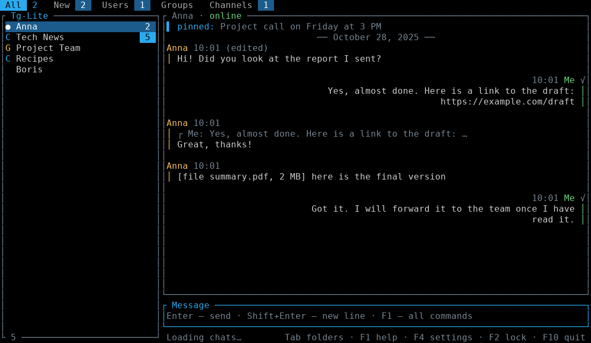

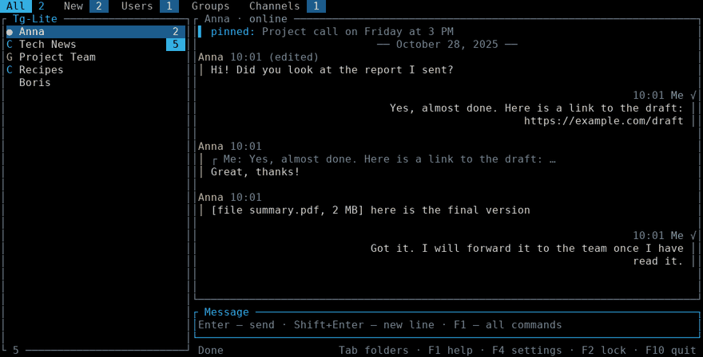

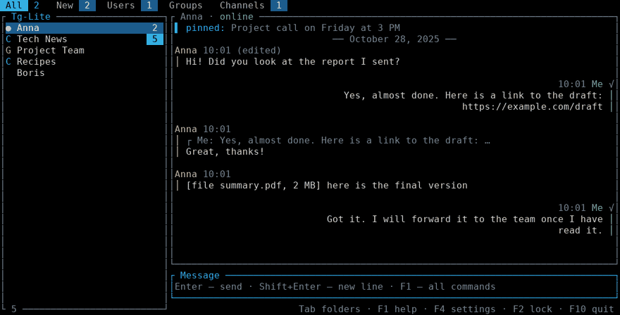

Tg-Lite is an unofficial Telegram client written in Rust for old and weak computers (it was built on a Pentium T4400
with 2 GB of RAM and a hard disk, where Telegram Desktop crawls). There is no Qt and no Electron: the interface is drawn
right in the console, and memory only holds the latest messages of the chats you have opened.

> Unofficial client. It speaks the open Telegram protocol (MTProto) through the
> [grammers](https://github.com/Lonami/grammers) library. You need your own `api_id` and `api_hash` from <https://my.telegram.org>.

## Contents
[Numbers](#numbers) · [Features](#features) · [Requirements](#requirements) · [Quick start](#quick-start) · [Keys and commands](#keys-and-commands) ·
[Security](#security) · [Proxy](#proxy) · [Build](#build) · [FAQ](#faq) · [Limits](#limits) · [Roadmap](#roadmap) · [License](#license)

## Numbers

Measured on a Lenovo B550 (Pentium T4400, 2 GB DDR2, HDD, Windows 10 LTSC):

| | Tg-Lite (measured) | Telegram Desktop |
|---|---|---|
| RAM, chat screen right after start | **2.8 MB** | 800 MB and more¹ |
| RAM after 10–15 minutes of use | **2.8 MB** | up to 2–2.5 GB after long use¹ |
| RAM after 10–15 minutes of browsing many chats and opening files (measured on 1.0.2) | **12.3 MB**, then stays flat | up to 2–2.5 GB after long use¹ |
| RAM on the lock screen with the animated background | **2.9 MB** | – |
| CPU | ~0 % on the chat screen, 1.4–2 % while the animated lock screen is shown | depends on version and number of chats |
| Start to chat list | about 1 second | – |
| Size | one exe, about **5 MB** (it was 3934 KB on 0.0.8 and grew with the features; the exact size is on the release page) | tens of MB installed plus cache |
| Installation | none, put the exe in any folder | installer |

How it was measured: Windows 10 LTSC, one account with the usual set of chats, Task Manager → Details, column "Memory (private working set)". The first rows are from 0.0.8 (start and 10–15 minutes of ordinary use); the 12.3 MB row is from 1.0.2 after 10–15 minutes of opening many different chats and files, and the figure did not grow further. Memory grows with the number of chats you have opened, because their latest messages are kept in memory (up to 1500 per chat). It is not a fully like-for-like comparison: Tg-Lite is mostly text and does less than Telegram Desktop. Other columns also count shared system libraries and show more. To measure on your own PC: start `tg-lite.exe`, open a chat and run `powershell -ExecutionPolicy Bypass -File tools\measure.ps1 -Minutes 10` (it prints a ready table row). A test in the repository also checks that 100 chats with 60 messages each stay under 4 MB of heap (about 2.2 MB now).

¹ Telegram Desktop figures are user reports, not lab measurements: [tdesktop #30151](https://github.com/telegramdesktop/tdesktop/issues/30151)
("starts use RAM up to 2.0-2.5gb", "less than 800mb" after a restart). The real value depends a lot on how many chats
and media you have open, so measure it on your own computer. Tg-Lite shows messages as text; a photo is decoded only when you ask for it (`P`) and only at a small size, and video is not decoded at all,
which is the main reason it is so small.

## Features

**Chats**
- Sign in by phone number and code (plus your cloud password if you have one).
- Tabs: All, New (unread), Users, Groups, Channels and your own Telegram folders.
- Online / last seen (within the other person's privacy settings), unread counters, the unread total in the window title.
- Live updates: new, edited and deleted messages; "typing…" and "recording voice…" in the chat header; `@` marks mentions.
- The status line shows the connection: `● 42 ms` (ping to Telegram) or `○ no connection`. While there is no network, sent messages wait in a queue (up to 30, shown grey with ⏳) and go out by themselves in order when the connection returns; a message Telegram refuses returns to the input box. In the rare case when the connection dropped exactly after a message reached Telegram, it can be sent twice.
- A separate draft per chat; if sending fails the text returns to the input box. Cloud drafts: unsent text is saved in Telegram (when you switch chats or stop typing for a few seconds), so it shows up on your phone, and a draft typed on the phone appears here. Can be turned off in the settings; commands starting with `/` are never uploaded.
- Channel posts show their view count next to the time (as loaded; it is not refreshed live).
- A pinned message is shown above the conversation.
- Three window layouts: the setting "View" or `/view` (with no word it switches to the next one); the classic one stays the default. **Messenger**: every chat in the list gets a second line with its latest message (or your unsent draft, or "typing…"), messages of one author are grouped under a single name, and a "new messages" line marks where the unread ones begin. **Two panes**: two chats side by side with the open chats as tabs on top; `Ctrl+←` / `Ctrl+→` or `F8` (or a click) switch the active pane, `Tab` goes through the open chats, `Ctrl+W` closes a tab, `↑ ↓` scroll the conversation. A chat visible in either pane counts as read. On a console narrower than 64 columns only the active pane is drawn.
- `Ctrl+K` opens a quick switcher: type the first letters of a chat name (a word typed on the wrong keyboard layout still finds it) and press `Enter`; start with `/` to run a command instead. `Ctrl+N` (or `/next`) jumps to the next chat with unread messages, chats where you were mentioned first. `Alt+1` … `Alt+9` open your pinned chats by their number in the list (pin one with `/pin`).
- Quiet: `/mute` turns off sound and notifications for the open chat (chats muted in Telegram are respected too, and muted chats are not counted in the unread total of the window title); `/dnd 30` silences everything for 30 minutes (`/dnd off` ends it); the setting "Quiet hours" keeps the night quiet (22:00–07:00, 23:00–08:00, 00:00–09:00 or 01:00–10:00). `/mute` is kept in Tg-Lite only, Telegram's own settings are not changed.
- `/drafts` lists the chats where unsent text is waiting; `Enter` opens one.

**Messages**
- `F7` picks a message: reply with a quote (R), forward (F), edit (E), delete (D), copy the text (C), save the attachment (S), open it (O), links (L). Also in `F7`: `G` jumps to the original of a reply (and `B` goes back), `1`–`6` set a reaction (👍 ❤ 🔥 😂 😮 😢; the same digit again or `0` removes yours), `K` lists the buttons of a bot message, `V` votes in a poll, `P` shows a photo right in the console, `T` reads a text file (txt, md, log, json, csv, xml, yml, toml, ini… up to 1 MB) in a window (`↑ ↓ PgUp PgDn`, `Esc` closes); for voice, music and video the hint shows `O`, which plays it in your system player. `Space` marks a message (also `Shift+↑`/`Shift+↓`); then `F` forwards, `D` deletes (your own only, press twice) and `C` copies all marked ones at once, `Esc` clears the marks.
- Reactions are shown under a message as short words, because the console draws no emoji: `+1 3  <3 2` (yours in brackets: `[<3 2]`). They are read when the messages are loaded; a reaction from another person appears after the chat is opened again. Bots' inline buttons are shown as `[Yes] [No]`; press them in the `K` list with Enter or a digit. Link buttons (`↗`) open in the browser; buttons that need a password, games, payments and web apps are not supported.
- Day separators say `Today` and `Yesterday`; names in groups have a stable color.
- `/edit` and `/del` act on your last message in the open chat (`/del` asks you to repeat it to confirm), `/note` (quick note to Saved Messages), `/later 30 text` (schedule in 30 minutes), `/scheduled` (list and cancel).
- Markdown (`F3` or `/md`): `**bold**`, `_italic_`, `` `code` ``, `[link](https://…)`.
- Reply quotes, forwarded-from notes and "(edited)" marks. Photos, voice and files appear as labels such as `[photo]`, `[file report.pdf, 2 MB]`.
- A message longer than 4096 characters (Telegram's limit) goes out as several messages in order, split at a paragraph, a line, a sentence or a word; in Markdown mode a code block is closed at the end of a part and opened again in the next. At most 12 parts, and the input box takes up to 40 000 characters; for more, send a file with `/send`. If a part fails, the unsent rest comes back to the input box of that chat (or to its draft if you have switched chats).
- A link gets a small card under the message (site and title, then the start of the description) when Telegram supplies a preview. The program only shows what Telegram sent; it never visits the link itself.
- The `F7` hint and keys offer only what can work for the selected message: `O` is named "listen", "watch" or "open" and appears only for a file of a safe type up to 50 MB that Windows has a program for (otherwise the status line says why), `T` only for text files, `E` only where Telegram allows editing, `G` only for replies, and so on.

**Files and links**
- `/send path [caption]` uploads a file up to 2000 MB (drag a file into the window to paste its path). jpg, jpeg and png pictures go as photos, everything else as a file. With the setting "Shrink photos on send" (on by default) a big picture is first scaled down to at most 2048 pixels on its longer side and saved as JPEG in memory, with the phone's rotation kept, so a photo from a phone uploads much faster on a slow link; the original file is never changed, and small files, pictures with transparency and anything that cannot be read are sent as they are. With the setting off only pictures under 10 MB go as photos.
- `/save` downloads an attachment to the `downloads` folder next to the exe, with progress in the status bar.
- `/open` (or `O` in `F7`) downloads an attachment to the temporary `tglite-view` folder and opens it with the default Windows program. Only pictures, PDF, plain text, JSON, audio and video up to 50 MB are opened this way (never programs, scripts or spreadsheets); the `tglite-view` folder is emptied on lock, on exit and on the next start.
- `/copy` (or `C` in `F7`) puts the text of a message on the clipboard.
- `P` in `F7` shows a small copy of a photo made of colored half-blocks (needs a terminal with true color, such as Windows Terminal; any key closes it). `Ctrl+V` (or `/paste`) with a screenshot on the clipboard and no text sends it as a photo, the text typed in the input becomes its caption.
- `/album path1 path2 … [-- caption]` sends 2–10 photos as one album message (paths with spaces in quotes; every file is checked before sending).
- Polls are drawn with the options, percentages and your choice; `V` in `F7` votes (one option; closed polls cannot be voted).
- `/links` lists links of the chat, Enter opens one in the browser.
- `/export [format]` saves the open conversation (the messages loaded in memory) next to the exe as `export/<chat>.<format>`: `txt` (the default), `md` (Markdown), `html` (one self-contained page for a browser: links are clickable, nothing is loaded from the internet and no scripts are used) or `json` (every message with its id, time, author, text, reply, forward, reactions and attachment name). Unlike the rest of the program these files are not encrypted.

**Managing chats**
- `/findmsg text` searches messages in the open chat, `/findall text` in all chats (up to 40 results); `Enter` on a result opens it in its surroundings (`PgDn` or `Esc` goes back to the latest messages, also `/latest`). `PgUp` at the top of a conversation loads older messages (up to 1500 per chat; use search beyond that).
- Read marks in private chats: `√` next to your message means sent, `√√` means the other person has read it (not shown in groups, channels and Saved Messages).
- `/pinned` lists all pinned messages of the open chat (`Enter` opens one in its surroundings).
- `/topics` lists the topics of a forum group; `Enter` on one makes your messages go into that topic (shown in the input title; `/topics off` returns to the general feed). The conversation itself is still shown as one feed, topics are not opened separately.
- `/chat @name` finds a person or a channel by its public name and opens the chat, even if you have never written to them. `/join t.me/+code` or `/join @name` joins a group or channel by an invite link or a public name; `/leave` leaves the open group or channel (repeat it to confirm; not available in private chats).
- `/netcheck` tests each route to Telegram (direct, proxy) and every data center and says which one works; `/report` saves `tglite-report.txt` next to the exe, ready to attach to a bug report: program version, the Windows name, version, edition and build (for example "Windows 10 Enterprise LTSC 2021"), system and program architecture, processor, memory and free disk space, terminal type and size, which Windows tools are present, the network and proxy state, settings, the files of the program folder and the latest lines of the log. Message text, passwords, phone numbers, your Windows user name and proxy addresses are never included.
- `/find text` (`F6`, `Ctrl+F`) filters chats by name, `/pin` pins a chat, `/readall` marks everything read.

**Comfort**
- `Ctrl+Z` / `Ctrl+Y` undo and redo typing in the input (also on the Russian layout).
- Paste works: `Ctrl+V`, `Shift+Insert`, the terminal's own paste, or `/paste`.
- English and Russian interface (setting "Interface language", chosen at first start).
- Animated sign-in screen (always Aurora) and lock screen (Aurora, Matrix, Stars or none, your choice in settings).
- Mouse: click a tab or a chat, the wheel scrolls the conversation (over the chat list it moves the selection). Press the left button on a message and drag to mark several; hold the pointer at the top or bottom edge and the conversation scrolls by itself, faster the longer you hold. `Ctrl`+click marks one message. Can be turned off in the settings. While the mouse is on, selecting text by dragging and right-click paste may not work in the console (in Windows Terminal hold `Shift` to select); use `/copy` and `Ctrl+V`, or turn the mouse off.
- Settings are grouped into sections (Security, Connection, Messages and sound, Appearance, General): auto-lock, password, proxy, sound, Windows notifications (off by default; only "new message in <chat>" while you are away, never the text), status, number of messages, cloud drafts, accent color, theme (dark, light, high contrast, Solarized), widths, lock screen background, emoji in text (auto = only in Windows Terminal, always, never), self-destruct, language, mouse.
- `/faq` shows troubleshooting tips inside the program. `tglite.log` records errors and `tg-lite --debug` makes it detailed (never message text).
- Emoji, invisible characters and scripts other than Latin, Greek and Cyrillic are hidden: the old Windows console cannot draw them and the screen would fall apart. In Windows Terminal simple emoji are shown (setting "Emoji in text"); joined emoji, flags and skin tones stay hidden.

<table>
<tr>
<td>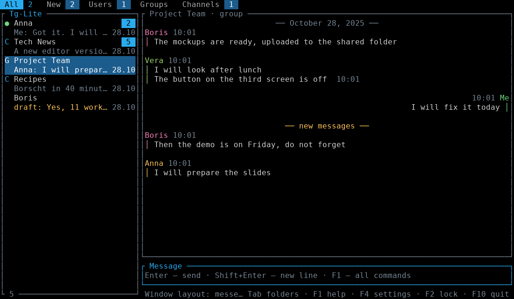</td>
<td>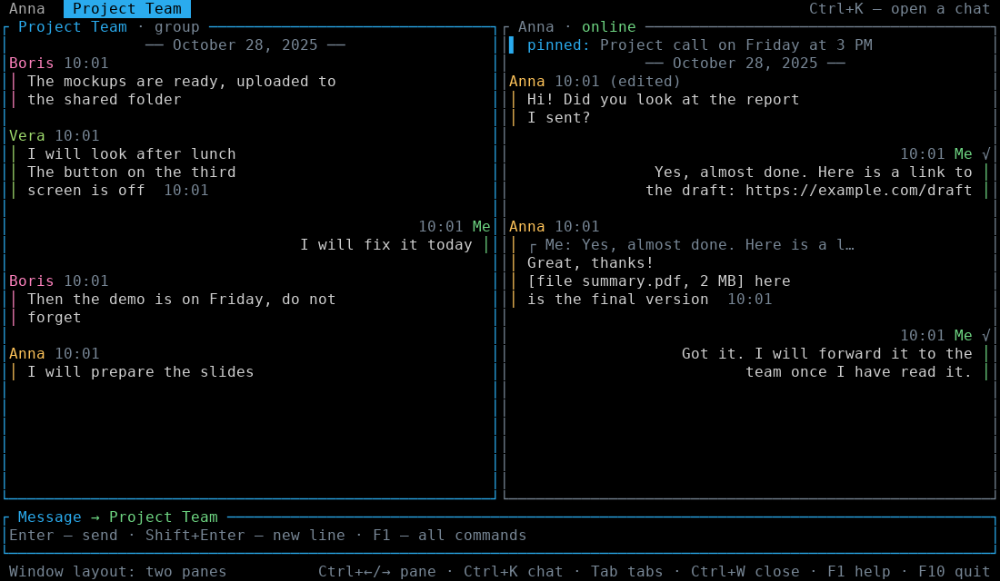</td>
</tr>
<tr>
<td>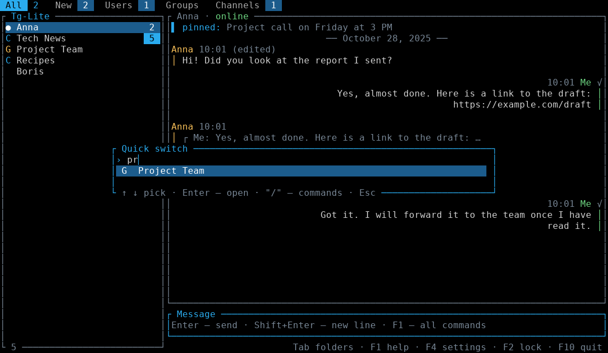</td>
<td>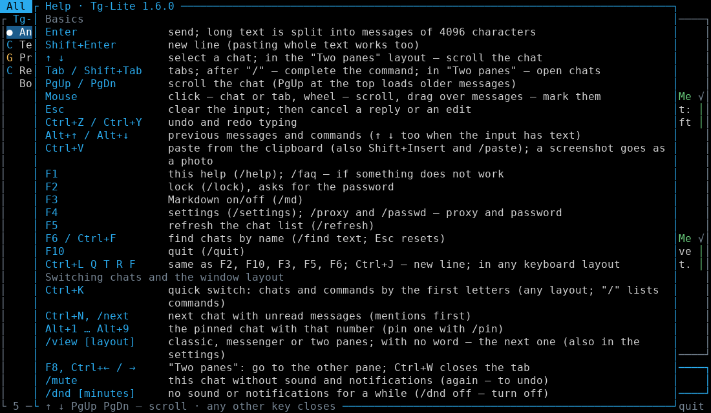</td>
</tr>
</table>

<table>
<tr>
<td>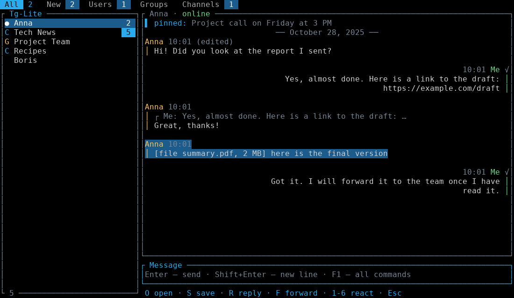</td>
<td>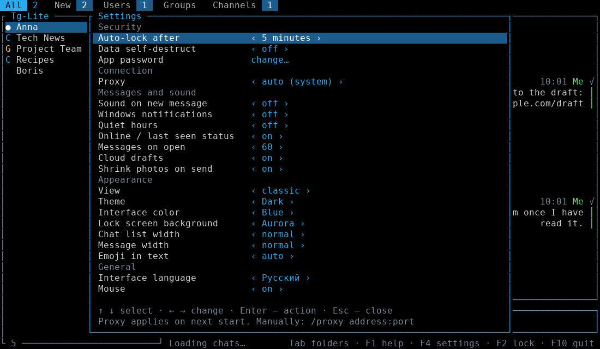</td>
</tr>
<tr>
<td>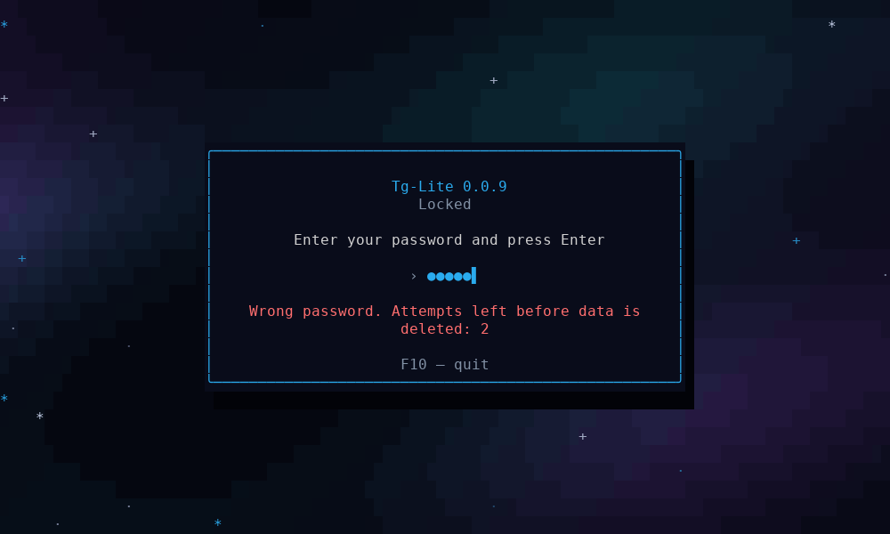</td>
<td>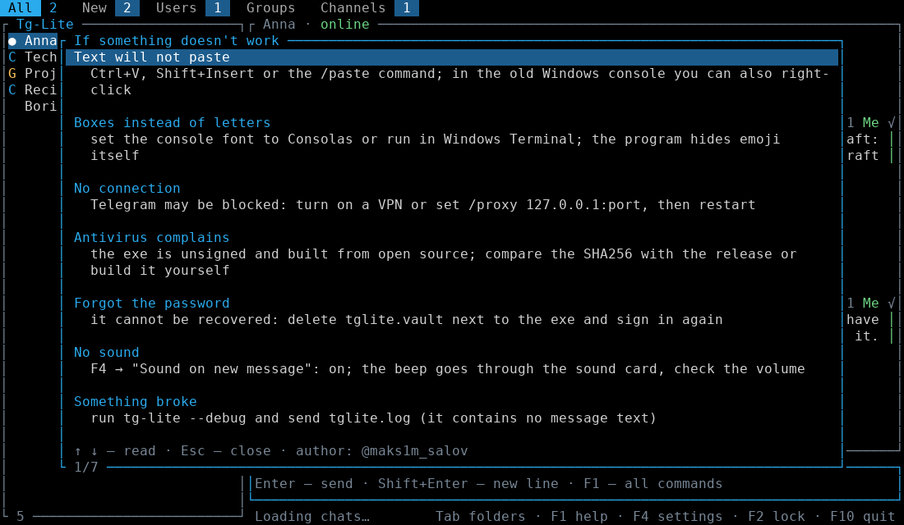</td>
</tr>
</table>

## Requirements

| | |
|---|---|
| OS | Windows 10 / 11, 64-bit (tested on Windows 10 LTSC). Windows 7/8 are not tested and not promised |
| Terminal | Windows Terminal or cmd (Consolas font recommended) |
| Network | direct connection, or a SOCKS5 / HTTP proxy (see [Proxy](#proxy)) |
| Rust | only if you build it yourself |

## Quick start

1. Download `tg-lite.exe` from [Releases](../../releases) (or the CI artifact), and check it: `Get-FileHash tg-lite.exe -Algorithm SHA256` must match the SHA256 in the release description or in `tg-lite.exe.sha256` if it is attached (letter case does not matter).
2. Run it, best from Windows Terminal or cmd with the Consolas font.
3. The first-run wizard has four steps (the language step is skipped if a language is already chosen, the keys step if the keys are built into the exe):
   1. choose the language;
   2. enter `api_id` and `api_hash` (create an app at <https://my.telegram.org> → API development tools, then copy both values);
   3. choose an app password (any length, even one character);
   4. enter your phone number and the code from Telegram.
4. From then on only the password is asked.

`tglite.vault` is created next to the exe (change the folder with the `TGLITE_DIR` environment variable).
**A forgotten password cannot be recovered**: delete `tglite.vault` and sign in again.

## Keys and commands

Every action has both a key and a command, in case a key does not work in your console.

| Key | Command | Action |
|---|---|---|
| Enter | | send |
| Shift+Enter | | new line (pasted multi-line text is kept together) |
| Ctrl+V / Shift+Insert | `/paste` | paste from the clipboard |
| ↑ / ↓, Tab / Shift+Tab | | choose a chat, switch tabs (after a leading `/`, Tab completes the command) |
| Alt+↑ / Alt+↓ | | earlier messages and commands (↑ ↓ do this too when the input has text) |
| PgUp / PgDn | | scroll the conversation; PgUp at the top loads older messages |
| Mouse | | click a tab or a chat, wheel scrolls (see settings) |
| Esc | | clear the input; then cancel edit or reply; then return to the latest messages after a search jump; then reset the chat filter |
| F1 | `/help` | help |
| F2 | `/lock` | lock |
| F3 | `/md` | Markdown on/off |
| F4 | `/settings` | settings |
| F5 | `/refresh` | refresh chat list |
| F6 | `/find text` | search chats |
| | `/findmsg text` `/findall text` `/latest` | search messages in this chat or everywhere, back to the latest messages |
| | `/pinned` | all pinned messages of the open chat |
| | `/netcheck` `/report` | which route to Telegram works; a safe text for bug reports |
| | `/topics` `/topics off` | topics of a forum group: pick one to write into; back to the general feed |
| | `/chat @name` | find a person or channel by name and open the chat |
| | `/join link-or-@name` `/leave` | join a group or channel; leave the open one (repeat to confirm) |
| F7 | | pick a message: R reply, F forward, E edit, D delete, C copy, S save, O open, L links, G original of a reply, B back, 1-6 reaction, K bot buttons, V vote, P photo, T read a text file, Space mark several |
| F10 | `/quit` | quit |
| | `/pin` `/readall` | pin chat, read everything |
| | `/export [format]` | save the conversation as txt, md, html or json |
| Ctrl+K | | quick switcher: chats and commands by their first letters |
| Ctrl+N | `/next` | next chat with unread messages (mentions first) |
| Alt+1 … Alt+9 | | open the pinned chat with that number |
| | `/view [name]` | window layout: `classic`, `messenger`, `panes` (no word: the next one) |
| F8, Ctrl+← / →, Ctrl+W | | two panes: switch the pane, close the tab (Tab goes through the open chats) |
| | `/mute` `/dnd [minutes]` `/drafts` | mute the chat, silence everything for a while, chats with unsent text |
| | `/edit` `/del` `/note` `/later` `/scheduled` | edit or delete your last message, note, schedule, scheduled list |
| Ctrl+Z / Ctrl+Y | | undo and redo in the input |
| | `/send` `/album` `/save` `/open` `/copy` `/links` | upload file, several photos as one album, download attachment, open attachment, copy message, links |
| | `/passwd` `/proxy` `/faq` | change password, proxy, troubleshooting |

`Ctrl+L`, `Ctrl+Q`, `Ctrl+T`, `Ctrl+R`, `Ctrl+F` also work, in the Latin and Russian keyboard layouts. `Alt+Enter` and `Ctrl+J` also insert a new line (Windows may take Alt+Enter for full screen).

## Security

- `api_id`, `api_hash` and the Telegram session live in `tglite.vault`, encrypted with your password (Argon2id + ChaCha20-Poly1305). Without the password the file cannot be read and tampering is detected.
- The conversation is never written to disk. Exceptions are `/export` and `/save`, which you run yourself (the exported files are plain text, HTML or JSON, not encrypted), and the short-lived files of `/open` (the `tglite-view` folder, emptied on lock, on exit and on start). The input history lives in memory only; drafts also live in memory here, and with cloud drafts on (default) the unsent text is stored by Telegram itself, like in any official app.
- Auto-lock after 1–60 minutes (or never) and on `F2`; the lock screen shows no messages. After three wrong passwords the lock screen makes you wait before the next try: 5, 10, 20 seconds and so on, up to 5 minutes. The count lives in memory and starts again after a restart, so this slows down guessing at the screen but is not a substitute for a strong password.
- Optional self-destruct: overwrite and delete `tglite.vault` after 3, 5 or 10 wrong passwords on the lock screen (off by default). Other files stay, and you should end the session in Telegram → Settings → Devices.
- The log never contains message text. The chosen language is stored in `tglite.lang` (not secret). `/report` leaves out message text, passwords, phone numbers, the Windows user name and proxy addresses. Photo shrinking and the splitting of long messages happen in memory; nothing extra is written to disk.

**Security model in short**

- *What is stored locally?* `tglite.vault` (keys and Telegram session, encrypted) and `tglite.lang` (language) always. Besides those only what you ask for or what the program lists: `tglite.log` (log, passwords hidden), `downloads/`, `export/` and the temporary `tglite-view/`. Messages are not stored.
- *What if I delete `tglite.vault`?* The program forgets the keys and the session; sign in again. End the old session in Telegram → Settings → Devices.
- *Is a third-party exe safe?* Not by default: the exe is unsigned. Download it only from this repository's Releases, compare SHA256 (shown in the CI job summary), or build it yourself.
- *Was the code audited?* It was reviewed and tested by the author and by automated checks (clippy, `cargo audit`). This is not an independent professional security audit.

Details and how to report a vulnerability: [SECURITY.md](SECURITY.md) (English and Russian).

## Proxy

Nothing needs to be typed. In "auto" mode the order is: manually set address, environment variables
(`TGLITE_PROXY`, `ALL_PROXY`, `HTTPS_PROXY`, `HTTP_PROXY`), the Windows system proxy, then a direct connection. Plain HTTP proxies are handled by a
small local bridge the program starts itself. If nothing works it asks for a proxy address (SOCKS5 or HTTP; Enter retries, `0` means no proxy, `q` quits) and remembers it (for example
`127.0.0.1:10808`). Manual: `/proxy 127.0.0.1:10808` uses only that address; `/proxy auto` restores the order above; `/proxy off` goes direct (applied on the next start). A proxy with a login: `/proxy user:password@127.0.0.1:3128` (for HTTP proxies an `@` or `:` inside the password is written as `%40` or `%3A`; the address must have a port). The password is never shown on screen or written to the log.

## Build

Install Rust (<https://rustup.rs>), then `cargo build --release`; the exe appears in `target/release/tg-lite.exe`.
Checks: `cargo fmt --check`, `cargo clippy --all-targets -- -D warnings`, `cargo test`.

Without installing Rust: push the project to GitHub. **CI** (`.github/workflows/ci.yml`) runs fmt, clippy and tests on Linux, `cargo audit`,
and builds the Windows exe (Actions → the run → Artifacts; the job summary shows the size and SHA256).
**Releases:** push a tag such as `git tag v1.0.0 && git push --tags`, and `release.yml` publishes `tg-lite.exe` with `tg-lite.exe.sha256`.

**API keys in the build.** In CI (`ci.yml`) the secrets `TGLITE_API_ID` and `TGLITE_API_HASH` bake your keys into the exe so they need not be
typed; the release workflow does not use them, so release exes never contain keys. Do not set these secrets in a public repository:
anyone can download the CI exe with your keys.

## FAQ

The same list is available in the program as `/faq`.

| Problem | What to do |
|---|---|
| Text will not paste | `Ctrl+V`, `Shift+Insert` or `/paste`; in the old Windows console right-click also works, but only with the mouse turned off in the settings |
| Boxes instead of letters | Use the Consolas font or Windows Terminal; the program hides emoji itself |
| No connection | Telegram may be blocked: use a VPN or `/proxy 127.0.0.1:port`, then restart |
| Antivirus complains | The exe is unsigned and built from open source; build it yourself or compare SHA256 with the release |
| Forgot the password | It cannot be recovered: delete `tglite.vault` and sign in again |
| No sound | `F4` → "Sound on new message": on; the click plays through the system sound, check the volume and that Windows audio is working |
| Anything else | Run `tg-lite --debug` and send `tglite.log` (no message text in it). Author: Telegram **@maks1m_salov** |

## Limits

- Mostly text: photos, voice, stickers and video are shown as labels (`P` draws a small copy of a photo, `/open` plays or shows an attachment in a Windows program, `/save` downloads it). Emoji are hidden.
- No secret chats and no calls.
- A text of more than 4096 characters is split into up to 12 messages. Photo shrinking handles JPEG and PNG files up to 40 MB (JPEG up to 64 million pixels, PNG up to 25 million); anything bigger or in another format is sent as it is.
- The two-pane layout needs at least 64 columns; on a narrower console only the active pane is shown.
- Up to 3000 chats are loaded (the first 100 appear at once, the rest follow); all tabs and folders are built from them. At most 1500 messages per chat are kept in memory.
- The proxy mode is applied on the next start; the sign-in screen always uses the "Aurora" background (settings are inside the encrypted vault).
- Self-destruct works on the lock screen, not at the startup password prompt.
- If Telegram is blocked where you live you need a VPN or a proxy.
- HTTP proxies with a login are supported as `/proxy user:password@host:port` (basic authorization only; the password is kept in the encrypted vault).
- Telegram is a trademark of its owners; this project is not affiliated with them.

## Roadmap

**1.6.0 (this version):** three window layouts (classic, messenger, two panes), `Ctrl+K` quick switcher, `Ctrl+N` / `/next` for the next unread chat, `Alt+1` … `Alt+9` for pinned chats, `/mute`, `/dnd` and quiet hours, `/drafts`, link cards, long messages split automatically, `/export` as txt, md, html or json, photos shrunk before sending, a detailed `/report`, `F7` offering only what works for the selected message, and a scrollable help window that fits a 30-row console. A full audit of the code brought a series of fixes as well: a crash on odd poll data, damaged pictures, an unreadable setting, a silent failure to save to disk and more (see the [changelog](CHANGELOG.md)).

**1.5.0:** settings split into sections, several photos in one message (`/album`), reading text files inside the window (`T`), undo and redo in the input (`Ctrl+Z` / `Ctrl+Y`), Windows notifications, emoji in Windows Terminal, `/netcheck` (which route to Telegram works) and `/report` (a safe text for bug reports).

**1.4.0:** connection indicator and an outgoing queue that waits for the network, marking several messages (keys or mouse drag with edge scrolling) to forward, delete or copy at once, polls with voting, forum topics to write into, photo preview in the console, a screenshot from the clipboard sent as a photo.

**1.3.1:** one new icon for the exe and the repository, a softer notification sound, and the session in Telegram → Settings → Devices is now named `Tg-Lite v1.3.1 (Windows)`.

**1.3.0:** reactions (shown and set with `1`–`6` in `F7`), jump to the original of a reply (`G`, back with `B`), buttons of bot messages (`K`), a growing pause after wrong passwords, “Yesterday” in day separators, color themes (dark, light, high contrast, Solarized).

**1.2.0:** read marks in private chats, `/pinned`, `/chat @name`, `/join` and `/leave`, cloud drafts (synced with the phone), view counts under channel posts.

**1.1.0:** mouse (click a tab or a chat, wheel scrolling; can be turned off in the settings), a short demo GIF, measured memory use after long heavy use.

**1.0.2:** all chats instead of the first 120, older history on PgUp, message search (`/findmsg`, `/findall`) with the result opened in its context.

**1.0.1:** `/open` and `/copy`, input history on Alt+↑ / Alt+↓, HTTP proxies with a login.

**1.0.0** is the first complete release: clipboard paste, English and Russian interface, first-run wizard, built-in FAQ,
CI with checksummed releases, and a full code audit whose findings are covered by regression tests. Not planned: a graphical app with
photos, video and voice, tray mode, a reusable core crate.

## License

[MIT](LICENSE) © @maks1m_salov. Issues and ideas: Telegram **@maks1m_salov**.

---

# Tg-Lite на русском

**Крошечный клиент Telegram для терминала. Один небольшой exe (около 5 МБ), около 3 МБ памяти при запуске и до 12 МБ после долгой активной работы.**

[Скачать](https://github.com/MaksLeny/tg-lite/releases/latest) • [Быстрый старт](#быстрый-старт) • [Безопасность](SECURITY.md) • [История версий](CHANGELOG.md) • [Сообщить об ошибке](https://github.com/MaksLeny/tg-lite/issues/new/choose)

[English](#tg-lite) · Русский

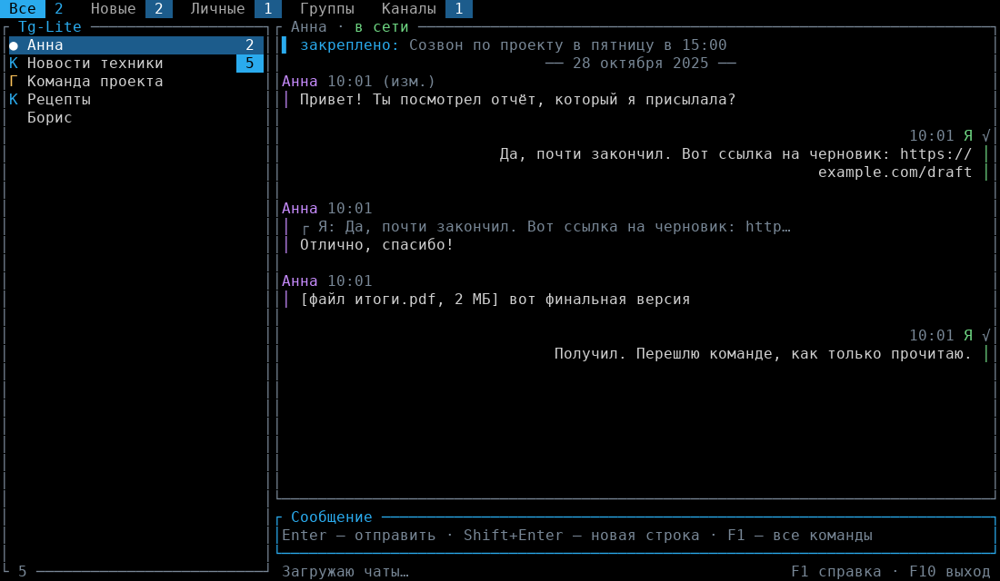

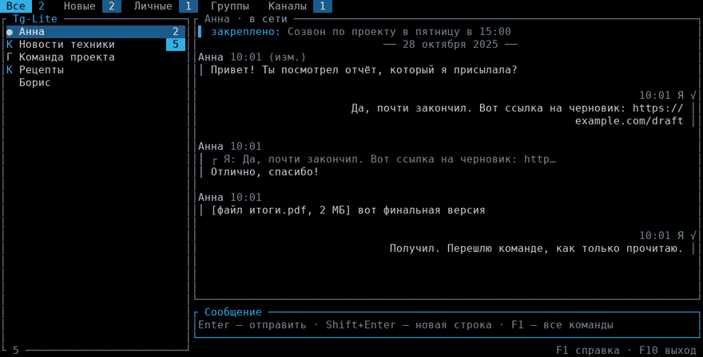

Tg-Lite — неофициальный клиент Telegram на Rust для старых и слабых компьютеров (он сделан на Pentium T4400 с 2 ГБ ОЗУ и
жёстким диском, где Telegram Desktop еле ворочается). Никакого Qt и Electron: интерфейс рисуется прямо в консоли, а в памяти
лежат только последние сообщения открытых вами чатов.

> Неофициальный клиент. Использует открытый протокол Telegram (MTProto) через библиотеку
> [grammers](https://github.com/Lonami/grammers). Нужны ваши собственные `api_id` и `api_hash` с <https://my.telegram.org>.

## Содержание
[Цифры](#цифры) · [Возможности](#возможности) · [Требования](#требования) · [Быстрый старт](#быстрый-старт) · [Клавиши и команды](#клавиши-и-команды) ·
[Безопасность](#безопасность) · [Прокси](#прокси) · [Сборка](#сборка) · [Если не работает](#если-не-работает) · [Ограничения](#ограничения) ·
[Планы](#планы) · [Лицензия](#лицензия)

## Цифры

Замеры на Lenovo B550 (Pentium T4400, 2 ГБ DDR2, жёсткий диск, Windows 10 LTSC):

| | Tg-Lite (замер) | Telegram Desktop |
|---|---|---|
| ОЗУ на экране чатов сразу после запуска | **2,8 МБ** | 800 МБ и больше¹ |
| ОЗУ через 10–15 минут работы | **2,8 МБ** | до 2–2,5 ГБ после долгой работы¹ |
| ОЗУ через 10–15 минут просмотра многих чатов и открытия файлов (замер на 1.0.2) | **12,3 МБ**, дальше не растёт | до 2–2,5 ГБ после долгой работы¹ |
| ОЗУ на экране блокировки с анимированным фоном | **2,9 МБ** | – |
| Процессор | ~0 % на экране чатов, 1,4–2 % пока показан анимированный экран блокировки | зависит от версии и числа чатов |
| От запуска до списка чатов | около секунды | – |
| Размер | один exe, около **5 МБ** (на 0.0.8 было 3934 КБ, с новыми возможностями вырос; точный размер указан на странице релиза) | десятки МБ установки плюс кэш |
| Установка | не нужна, exe кладётся в любую папку | установщик |

Как мерили: Windows 10 LTSC, один аккаунт с обычным набором чатов, Диспетчер задач → «Подробности», столбец «Память (закрытый рабочий набор)». Первые строки — на 0.0.8 (запуск и 10–15 минут обычной работы); строка 12,3 МБ — на 1.0.2 после 10–15 минут открытия множества разных чатов и файлов, дальше значение не росло. Память растёт вместе с числом открытых чатов, потому что их последние сообщения хранятся в памяти (до 1500 на чат). Сравнение не полностью равноценное: Tg-Lite в основном текстовый и умеет меньше, чем Telegram Desktop. Другие столбцы учитывают и общие системные библиотеки, поэтому показывают больше. Замерить у себя: запустите `tg-lite.exe`, откройте чат и выполните `powershell -ExecutionPolicy Bypass -File tools\measure.ps1 -Minutes 10` (скрипт выведет готовую строку для таблицы). Тест в репозитории следит, чтобы 100 чатов по 60 сообщений занимали меньше 4 МБ кучи (сейчас около 2,2 МБ).

¹ Данные по Telegram Desktop — отзывы пользователей, а не лабораторные замеры: [tdesktop #30151](https://github.com/telegramdesktop/tdesktop/issues/30151)
(«starts use RAM up to 2.0-2.5gb», после перезапуска «less than 800mb»). Реальный расход сильно зависит от числа чатов и
открытых медиа, поэтому проверьте у себя. Tg-Lite показывает сообщения текстом; фото раскодируется только по вашей просьбе (`P`) и в малом размере, а видео не раскодируется вовсе — отсюда такой малый размер.

## Возможности

**Чаты**
- Вход по номеру телефона и коду (и облачному паролю Telegram, если он включён).
- Вкладки: Все, Новые (с непрочитанными), Личные, Группы, Каналы и ваши папки из Telegram.
- «В сети» / «был(а) в сети» (в пределах приватности собеседника), счётчики непрочитанных, число в заголовке окна.
- Всё приходит само: новые, изменённые и удалённые сообщения; «печатает…» и «записывает голосовое…» в заголовке; значок `@` у упоминаний.
- В строке состояния видна связь: `● 42 мс` (пинг до Telegram) или `○ нет связи`. Пока сети нет, отправленные сообщения ждут в очереди (до 30, серым с ⏳) и уходят сами по порядку, когда связь вернётся; сообщение, которое Telegram отклонил, возвращается в поле ввода. В редком случае, когда связь оборвалась ровно после того, как сообщение дошло до Telegram, оно может уйти дважды.
- Свой черновик у каждого чата; если отправка не удалась, текст возвращается в поле ввода. Облачные черновики: неотправленный текст сохраняется в Telegram (при смене чата или когда вы несколько секунд не печатаете) и виден на телефоне, а черновик с телефона появляется здесь. Выключается в настройках; команды, начинающиеся с `/`, не отправляются.
- У постов каналов рядом со временем показано число просмотров (на момент загрузки, вживую не обновляется).
- Закреплённое сообщение показывается над перепиской.
- Три вида окна: настройка «Вид» или `/view` (без слова переключает на следующий); по умолчанию остаётся классический. **Мессенджер**: у каждого чата в списке вторая строка с последним сообщением (или вашим неотправленным черновиком, или «печатает…»), сообщения одного автора собраны под одним именем, а строка «новые сообщения» показывает, где начинаются непрочитанные. **Два окна**: два чата рядом, сверху вкладки открытых чатов; `Ctrl+←` / `Ctrl+→` или `F8` (или щелчок) переключают активное окно, `Tab` идёт по открытым чатам, `Ctrl+W` закрывает вкладку, `↑ ↓` листают переписку. Чат, видимый в любом из окон, считается прочитанным. В консоли меньше 64 столбцов рисуется только активное окно.
- `Ctrl+K` открывает быстрый переход: наберите первые буквы названия чата (слово, набранное не в той раскладке, тоже находится) и нажмите `Enter`; если начать с `/`, выполнится команда. `Ctrl+N` (или `/next`) переходит к следующему чату с непрочитанными, сначала с вашими упоминаниями. `Alt+1` … `Alt+9` открывают закреплённые чаты по их номеру в списке (закрепить — `/pin`).
- Тишина: `/mute` отключает звук и уведомления открытого чата (чаты, заглушённые в Telegram, тоже учитываются, а заглушённые чаты не входят в число непрочитанных в заголовке окна); `/dnd 30` заглушает всё на 30 минут (`/dnd off` — отменить); настройка «Тихие часы» хранит ночную тишину (22:00–07:00, 23:00–08:00, 00:00–09:00 или 01:00–10:00). `/mute` запоминается только в Tg-Lite, настройки самого Telegram не меняются.
- `/drafts` — чаты, где ждёт неотправленный текст; `Enter` открывает чат.

**Сообщения**
- `F7` — выбрать сообщение: ответить с цитатой (R), переслать (F), править (E), удалить (D), копировать текст (C), скачать вложение (S), открыть его (O), ссылки (L). Ещё в `F7`: `G` — перейти к оригиналу ответа (`B` — назад), `1`–`6` — поставить реакцию (👍 ❤ 🔥 😂 😮 😢; та же цифра ещё раз или `0` снимает вашу), `K` — список кнопок сообщения бота, `V` — голосовать в опросе, `P` — показать фото прямо в консоли, `T` — прочитать текстовый файл (txt, md, log, json, csv, xml, yml, toml, ini… до 1 МБ) в окне (`↑ ↓ PgUp PgDn`, закрыть — `Esc`); для голосовых, музыки и видео в подсказке есть `O` — проиграть системным плеером. `Пробел` отмечает сообщение (также `Shift+↑`/`Shift+↓`); затем `F` пересылает, `D` удаляет (только свои, нажать дважды) и `C` копирует все отмеченные сразу, `Esc` сбрасывает отметки.
- Реакции показываются под сообщением короткими словами, потому что консоль не рисует эмодзи: `+1 3  <3 2` (ваша — в скобках: `[<3 2]`). Они читаются при загрузке сообщений; реакция другого человека появится, когда вы снова откроете чат. Inline-кнопки ботов выглядят как `[Да] [Нет]`; нажимаются в списке `K` клавишей Enter или цифрой. Кнопки-ссылки (`↗`) открываются в браузере; кнопки с паролем, игры, платежи и веб-приложения не поддерживаются.
- Разделители дней подписаны «Сегодня» и «Вчера»; имена в группах имеют постоянный цвет.
- `/edit` и `/del` работают с вашим последним сообщением в открытом чате (`/del` просит повторить для подтверждения), `/note` (быстрая заметка в «Избранное»), `/later 30 текст` (отложить на 30 минут), `/scheduled` (список и отмена).
- Markdown (`F3` или `/md`): `**жирный**`, `_курсив_`, `` `код` ``, `[ссылка](https://…)`.
- Цитаты ответов, пометки «переслано» и «(изм.)». Фото, голосовые и файлы показываются подписями: `[фото]`, `[файл отчёт.pdf, 2 МБ]`.
- Сообщение длиннее 4096 знаков (лимит Telegram) уходит несколькими сообщениями по порядку: резать стараются по абзацу, строке, предложению или слову; в режиме Markdown блок кода закрывается в конце части и открывается снова в следующей. Не больше 12 частей, поле ввода принимает до 40 000 знаков; для большего отправьте файл через `/send`. Если часть не ушла, неотправленный остаток возвращается в поле ввода этого чата (или в его черновик, если вы уже перешли в другой).
- У ссылки под сообщением показывается небольшая карточка (сайт и заголовок, ниже начало описания), если Telegram прислал превью. Программа показывает только то, что прислал Telegram, и сама по ссылке не ходит.
- Подсказка и клавиши `F7` предлагают только то, что сработает для выбранного сообщения: `O` называется «слушать», «смотреть» или «открыть» и появляется только у файла безопасного типа до 50 МБ, для которого в Windows есть программа (иначе строка состояния объяснит, почему нет), `T` — только у текстовых файлов, `E` — только там, где Telegram разрешает правку, `G` — только у ответов и так далее.

**Файлы и ссылки**
- `/send путь подпись` — отправить файл (подпись необязательна) до 2000 МБ (путь можно просто перетащить в окно). Картинки jpg, jpeg и png идут как фото, остальное как файл. При включённой настройке «Сжимать фото при отправке» (по умолчанию включена) большая картинка сначала уменьшается до 2048 точек по длинной стороне и сохраняется в памяти как JPEG с сохранением поворота снимка, поэтому фото с телефона уходит заметно быстрее на медленной связи; исходный файл не меняется, а маленькие файлы, картинки с прозрачностью и всё, что не удалось прочитать, отправляются как есть. При выключенной настройке как фото идут только картинки меньше 10 МБ.
- `/save` — скачать вложение в папку `downloads` рядом с exe, с прогрессом в строке состояния.
- `/open` (или `O` в `F7`) скачивает вложение во временную папку `tglite-view` и открывает обычной программой Windows. Так открываются только картинки, PDF, простой текст, JSON, звук и видео до 50 МБ (никогда программы, скрипты и таблицы); папка `tglite-view` очищается при блокировке, выходе и следующем запуске.
- `/copy` (или `C` в `F7`) кладёт текст сообщения в буфер обмена.
- `P` в `F7` показывает уменьшенную копию фото из цветных полублоков (нужен терминал с полноцветным режимом, например Windows Terminal; любая клавиша закрывает). `Ctrl+V` (или `/paste`), когда в буфере обмена скриншот и нет текста, отправляет его как фото, а набранный в поле текст становится подписью.
- `/album путь1 путь2 … [-- подпись]` отправляет 2–10 фото одним альбомом (пути с пробелами — в кавычках; каждый файл проверяется до отправки).
- Опросы рисуются с вариантами, процентами и вашим выбором; `V` в `F7` — проголосовать (один вариант; в закрытом опросе голосовать нельзя).
- `/links` — ссылки чата, Enter открывает ссылку в браузере.
- `/export [формат]` сохраняет открытый чат (сообщения, загруженные в память) рядом с exe как `export/<чат>.<формат>`: `txt` (по умолчанию), `md` (Markdown), `html` (одна самостоятельная страница для браузера: ссылки кликабельны, из интернета ничего не загружается, скриптов нет) или `json` (каждое сообщение с номером, временем, автором, текстом, ответом, пересылкой, реакциями и именем вложения). В отличие от остальной программы эти файлы не зашифрованы.

**Управление чатами**
- `/findmsg текст` — поиск сообщений в открытом чате, `/findall текст` — во всех чатах (до 40 результатов); `Enter` на результате открывает его среди соседних сообщений (`PgDn` или `Esc` возвращает к последним, также `/latest`). `PgUp` у верха переписки подгружает старые сообщения (до 1500 на чат; дальше помогает поиск).
- Отметки прочтения в личных чатах: `√` у вашего сообщения — отправлено, `√√` — собеседник прочитал (в группах, каналах и «Избранном» не показываются).
- `/pinned` — список всех закреплённых сообщений открытого чата (`Enter` открывает сообщение среди соседних).
- `/topics` — список тем форума (группы с темами); `Enter` на теме — ваши сообщения уходят в эту тему (видно в заголовке поля ввода; `/topics off` возвращает в общий поток). Сама переписка по-прежнему показывается одной лентой, темы отдельно не открываются.
- `/chat @имя` находит человека или канал по публичному имени и открывает чат, даже если вы ему ещё не писали. `/join t.me/+код` или `/join @имя` — вступить в группу или канал по ссылке-приглашению или публичному имени; `/leave` — выйти из открытой группы или канала (повторите для подтверждения; в личных чатах недоступно).
- `/netcheck` проверяет каждый путь до Telegram (напрямую, прокси) и каждый дата-центр и говорит, какой работает; `/report` сохраняет `tglite-report.txt` рядом с exe, можно прикладывать к сообщению об ошибке: версия программы, название, версия, редакция и сборка Windows (например «Windows 10 Enterprise LTSC 2021»), разрядность системы и программы, процессор, память и свободное место на диске, тип и размер терминала, какие средства Windows есть, состояние сети и прокси, настройки, файлы папки программы и последние строки журнала. Текст сообщений, пароли, номера телефонов, имя пользователя Windows и адреса прокси в отчёт не попадают.
- `/find текст` (`F6`, `Ctrl+F`) — поиск по названиям, `/pin` — закрепить, `/readall` — всё прочитано.

**Удобство**
- `Ctrl+Z` / `Ctrl+Y` — отмена и повтор набора в поле ввода (и в русской раскладке).
- Вставка работает: `Ctrl+V`, `Shift+Insert`, вставка самого терминала или команда `/paste`.
- Интерфейс на русском и английском (настройка «Язык интерфейса», выбирается при первом запуске).
- Анимированный экран входа (всегда «Аврора») и экран блокировки («Аврора», «Матрица», «Звёзды» или без анимации, выбирается в настройках).
- Мышь: клик по вкладке или чату, колесо прокручивает переписку (над списком чатов двигает выбор). Зажмите левую кнопку на сообщении и протяните — отметится несколько; если держать указатель у верхнего или нижнего края, переписка листается сама, тем быстрее, чем дольше держите. `Ctrl`+щелчок отмечает одно сообщение. Выключается в настройках. Пока мышь включена, выделение текста протягиванием и вставка правой кнопкой в консоли могут не работать (в Windows Terminal выделять можно с зажатым `Shift`); используйте `/copy` и `Ctrl+V` или выключите мышь.
- Настройки собраны в разделы (Защита, Подключение, Сообщения и звук, Внешний вид, Общие): автоблокировка, пароль, прокси, звук, уведомления Windows (по умолчанию выключены; только «новое сообщение в <чат>», пока вы отошли, текст не показывается), статусы, число сообщений, облачные черновики, цвет, тема (тёмная, светлая, высокий контраст, Solarized), ширина, фон блокировки, эмодзи в тексте (авто — только в Windows Terminal, всегда, никогда), самоуничтожение, язык, мышь.
- `/faq` — подсказки «Если не работает» прямо в программе. В `tglite.log` пишутся ошибки, а `tg-lite --debug` делает журнал подробным (тексты переписки не пишутся никогда).
- Эмодзи, невидимые символы и письменности кроме латиницы, греческого и кириллицы скрываются: старая консоль Windows не умеет их рисовать, и экран «рассыпался» бы. В Windows Terminal простые эмодзи показываются (настройка «Эмодзи в тексте»); составные эмодзи, флаги и оттенки кожи остаются скрытыми.

<table>
<tr>
<td>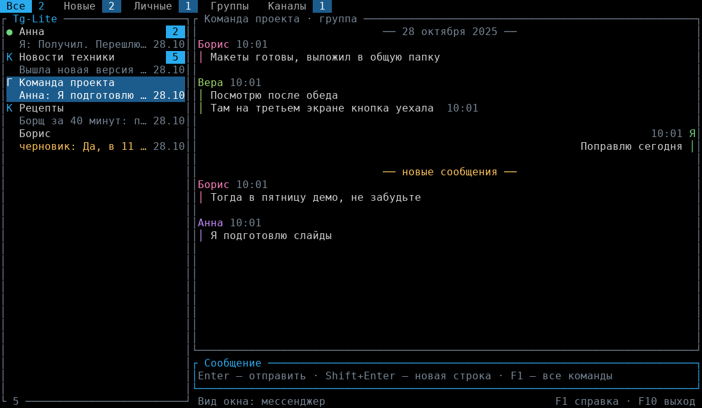</td>
<td>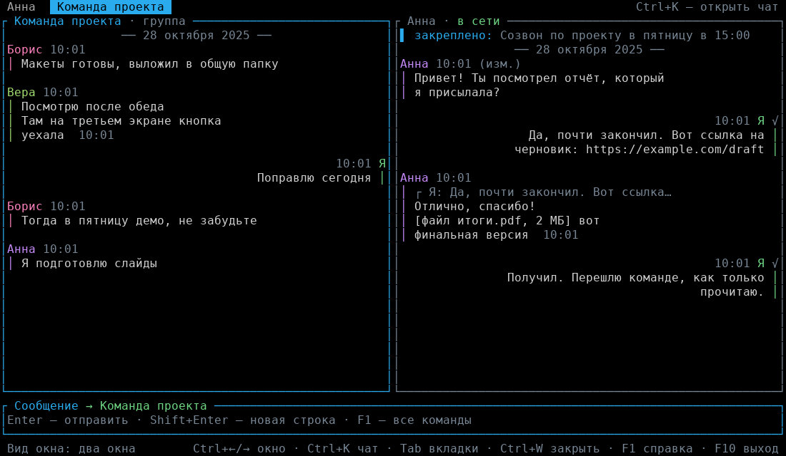</td>
</tr>
<tr>
<td>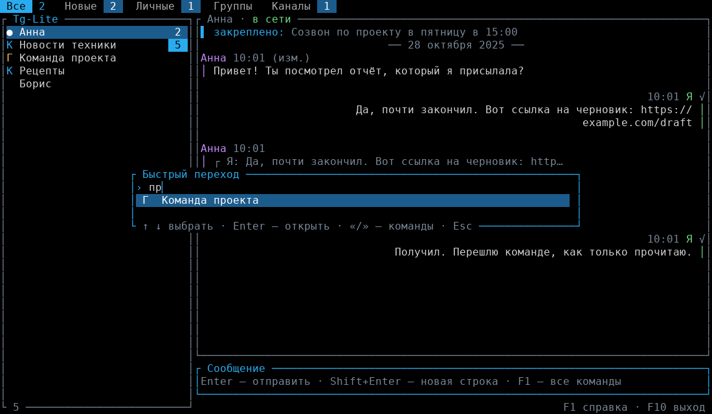</td>
<td>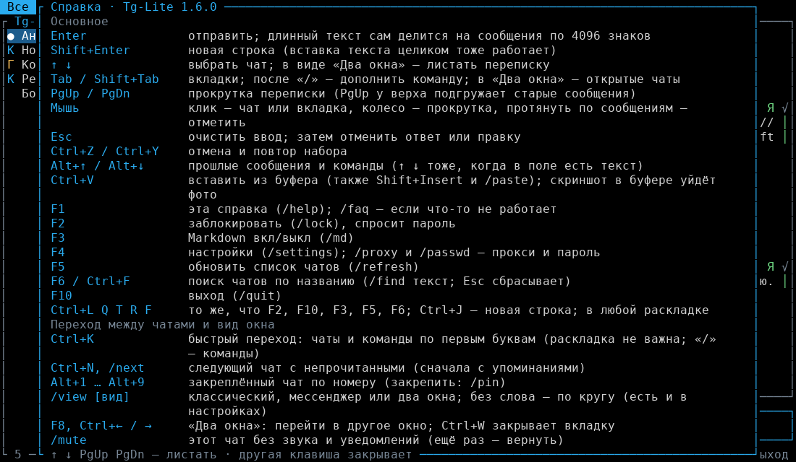</td>
</tr>
</table>

<table>
<tr>
<td>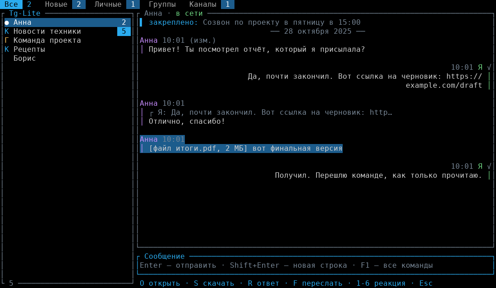</td>
<td>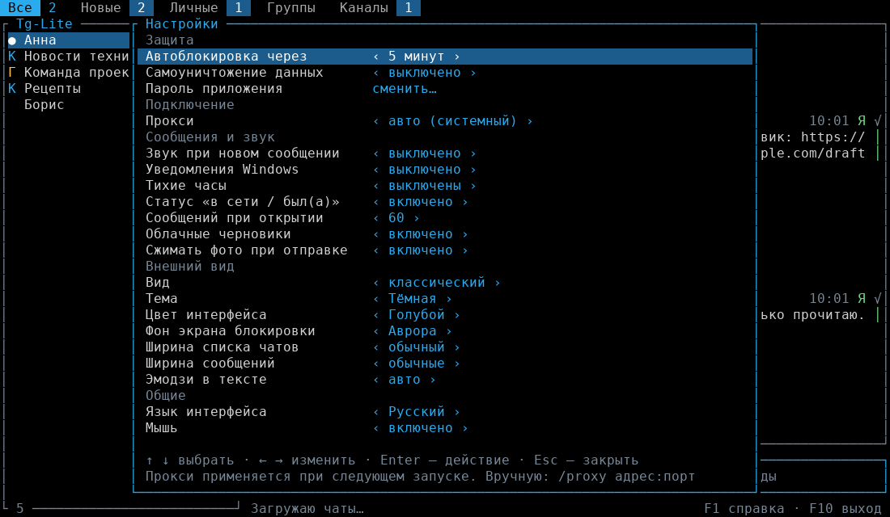</td>
</tr>
<tr>
<td>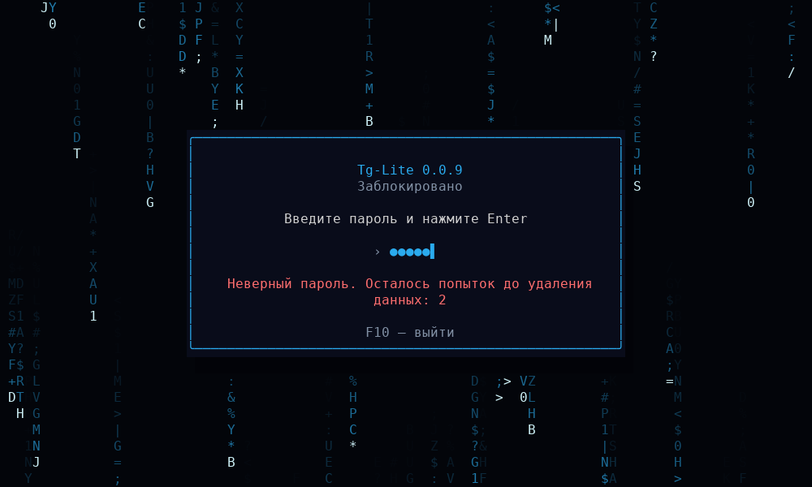</td>
<td>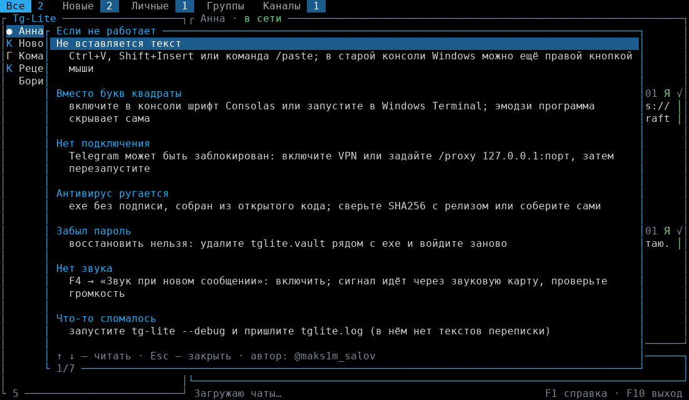</td>
</tr>
</table>

## Требования

| | |
|---|---|
| ОС | Windows 10 / 11, 64 бита (проверено на Windows 10 LTSC). Windows 7/8 не проверялись и не обещаются |
| Терминал | Windows Terminal или cmd (лучше шрифт Consolas) |
| Сеть | прямое соединение или прокси SOCKS5 / HTTP (см. [Прокси](#прокси)) |
| Rust | нужен только для самостоятельной сборки |

## Быстрый старт

1. Скачайте `tg-lite.exe` из [Releases](../../releases) (или артефакт CI) и проверьте: `Get-FileHash tg-lite.exe -Algorithm SHA256` должен совпасть с SHA256 из описания релиза или с `tg-lite.exe.sha256`, если он приложен (регистр букв не важен).
2. Запустите, лучше из Windows Terminal или cmd со шрифтом Consolas.
3. Мастер первого запуска — четыре шага (шаг языка пропускается, если язык уже выбран, шаг ключей — если ключи вшиты в exe):
   1. выбор языка;
   2. ввод `api_id` и `api_hash` (создайте приложение на <https://my.telegram.org> → API development tools и скопируйте оба значения);
   3. пароль приложения (любой длины, даже один символ);
   4. номер телефона и код из Telegram.
4. Дальше при каждом запуске спрашивается только пароль.

`tglite.vault` создаётся рядом с exe (папку можно сменить переменной окружения `TGLITE_DIR`).
**Забытый пароль восстановить нельзя**: удалите `tglite.vault` и войдите заново.

## Клавиши и команды

Каждое действие есть и клавишей, и командой — на случай, если клавиша не работает в вашей консоли.

| Клавиша | Команда | Действие |
|---|---|---|
| Enter | | отправить |
| Shift+Enter | | новая строка (вставленный многострочный текст не рвётся) |
| Ctrl+V / Shift+Insert | `/paste` | вставить из буфера обмена |
| ↑ / ↓, Tab / Shift+Tab | | выбор чата, вкладки (после начального `/` Tab дополняет команду) |
| Alt+↑ / Alt+↓ | | прошлые сообщения и команды (↑ ↓ делают то же, когда в поле есть текст) |
| PgUp / PgDn | | прокрутка переписки; PgUp у верха подгружает старые сообщения |
| Мышь | | клик по вкладке или чату, колесо — прокрутка (см. настройки) |
| Esc | | очистить ввод; затем отменить правку или ответ; затем вернуться к последним после перехода из поиска; затем сбросить фильтр чатов |
| F1 | `/help` | справка |
| F2 | `/lock` | заблокировать |
| F3 | `/md` | Markdown вкл/выкл |
| F4 | `/settings` | настройки |
| F5 | `/refresh` | обновить список чатов |
| F6 | `/find текст` | поиск по чатам |
| | `/findmsg текст` `/findall текст` `/latest` | поиск сообщений в этом чате или везде, назад к последним |
| | `/pinned` | все закреплённые сообщения открытого чата |
| | `/netcheck` `/report` | какой путь до Telegram работает; безопасный текст для сообщения об ошибке |
| | `/topics` `/topics off` | темы форума: выбрать, куда писать; назад в общий поток |
| | `/chat @имя` | найти человека или канал по имени и открыть чат |
| | `/join ссылка-или-@имя` `/leave` | вступить в группу или канал; выйти из открытого (повторите для подтверждения) |
| F7 | | выбор сообщения: R ответить, F переслать, E править, D удалить, C копировать, S скачать, O открыть, L ссылки, G оригинал ответа, B назад, 1-6 реакция, K кнопки бота, V голос, P фото, T читать текстовый файл, Пробел — отметить несколько |
| F10 | `/quit` | выход |
| | `/pin` `/readall` | закрепить чат, прочитать всё |
| | `/export [формат]` | сохранить переписку как txt, md, html или json |
| Ctrl+K | | быстрый переход: чаты и команды по первым буквам |
| Ctrl+N | `/next` | следующий чат с непрочитанными (сначала с упоминаниями) |
| Alt+1 … Alt+9 | | открыть закреплённый чат с этим номером |
| | `/view [название]` | вид окна: `classic`, `messenger`, `panes` (без слова — следующий) |
| F8, Ctrl+← / →, Ctrl+W | | два окна: переключить окно, закрыть вкладку (Tab идёт по открытым чатам) |
| | `/mute` `/dnd [минуты]` `/drafts` | заглушить чат, заглушить всё на время, чаты с неотправленным текстом |
| | `/edit` `/del` `/note` `/later` `/scheduled` | править или удалить своё последнее сообщение, заметка, отложить, список отложенных |
| Ctrl+Z / Ctrl+Y | | отмена и повтор в поле ввода |
| | `/send` `/album` `/save` `/open` `/copy` `/links` | отправить файл, несколько фото одним альбомом, скачать вложение, открыть вложение, копировать сообщение, ссылки |
| | `/passwd` `/proxy` `/faq` | сменить пароль, прокси, подсказки |

`Ctrl+L`, `Ctrl+Q`, `Ctrl+T`, `Ctrl+R`, `Ctrl+F` тоже работают, в латинской и русской раскладках. `Alt+Enter` и `Ctrl+J` тоже вставляют новую строку (Windows может забрать Alt+Enter для полноэкранного режима).

## Безопасность

- `api_id`, `api_hash` и сессия Telegram лежат в `tglite.vault`, зашифрованном вашим паролем (Argon2id + ChaCha20-Poly1305). Без пароля файл не прочитать, подмена данных обнаруживается.
- Переписка на диск не пишется. Исключения — `/export` и `/save`, которые вы запускаете сами (экспортированные файлы — обычный текст, HTML или JSON, без шифрования), и недолгие файлы `/open` (папка `tglite-view`, очищается при блокировке, выходе и запуске). История ввода живёт только в памяти; черновики здесь тоже в памяти, а при включённых облачных черновиках (по умолчанию) неотправленный текст хранит сам Telegram, как в любом официальном приложении.
- Автоблокировка через 1–60 минут (или никогда) и по `F2`; на экране блокировки переписки нет. После трёх неверных паролей экран блокировки заставляет подождать перед следующей попыткой: 5, 10, 20 секунд и так далее, до 5 минут. Счётчик живёт в памяти и после перезапуска начинается заново, поэтому это замедляет подбор у экрана, но не заменяет надёжный пароль.
- Самоуничтожение по желанию: затереть и удалить `tglite.vault` после 3, 5 или 10 неверных паролей на экране блокировки (по умолчанию выключено). Остальные файлы остаются; завершите сессию в Telegram → Настройки → Устройства.
- В журнале нет текстов сообщений. Выбранный язык хранится в `tglite.lang` (не секрет). В `/report` нет текста сообщений, паролей, номеров телефонов, имени пользователя Windows и адресов прокси. Сжатие фото и деление длинных сообщений происходит в памяти, на диск ничего лишнего не пишется.

**Модель безопасности кратко**

- *Что хранится на диске?* Всегда `tglite.vault` (ключи и сессия Telegram, зашифрованы) и `tglite.lang` (язык). Кроме них только то, что вы запросили или что перечислено здесь: `tglite.log` (журнал, пароли скрыты), `downloads/`, `export/` и временная `tglite-view/`. Сообщения не сохраняются.
- *Что будет, если удалить `tglite.vault`?* Программа забудет ключи и сессию, войти нужно заново. Старую сессию завершите в Telegram → Настройки → Устройства.
- *Безопасен ли чужой exe?* По умолчанию нет: exe не подписан. Скачивайте только из Releases этого репозитория, сверяйте SHA256 (виден в сводке CI) или собирайте сами.
- *Был ли аудит кода?* Код проверен и протестирован автором и автоматикой (clippy, `cargo audit`). Это не независимый профессиональный аудит безопасности.

Подробности и как сообщить об уязвимости: [SECURITY.md](SECURITY.md) (на русском и английском).

## Прокси

Вводить ничего не нужно. Порядок в режиме «авто»: адрес, заданный вручную, переменные окружения
(`TGLITE_PROXY`, `ALL_PROXY`, `HTTPS_PROXY`, `HTTP_PROXY`), системный прокси Windows, затем напрямую. Для обычных HTTP-прокси программа сама поднимает
небольшой локальный мост. Если ничего не сработало, спросит адрес прокси (SOCKS5 или HTTP; Enter повторяет, `0` — без прокси, `q` — выход) и запомнит его (например `127.0.0.1:10808`).
Вручную: `/proxy 127.0.0.1:10808` использует только этот адрес, `/proxy auto` возвращает порядок выше, `/proxy off` — напрямую (применяется при следующем запуске). Прокси с логином: `/proxy логин:пароль@127.0.0.1:3128` (для HTTP-прокси `@` или `:` внутри пароля пишутся как `%40` и `%3A`; в адресе обязателен порт). Пароль не показывается на экране и не попадает в журнал.

## Сборка

Нужен Rust (<https://rustup.rs>): `cargo build --release`, файл появится в `target/release/tg-lite.exe`.
Проверки: `cargo fmt --check`, `cargo clippy --all-targets -- -D warnings`, `cargo test`.

Без установки Rust: залейте проект на GitHub. **CI** (`.github/workflows/ci.yml`) гоняет fmt, clippy и тесты на Linux, `cargo audit`
и собирает exe под Windows (Actions → запуск → Artifacts; в сводке задания видны размер и SHA256).
**Релизы:** создайте тег, например `git tag v1.0.0 && git push --tags`, и `release.yml` опубликует `tg-lite.exe` вместе с `tg-lite.exe.sha256`.

**Ключи API в сборке.** В CI (`ci.yml`) секреты `TGLITE_API_ID` и `TGLITE_API_HASH` вшивают ваши ключи в exe, и вводить их не придётся;
workflow релиза их не использует, поэтому exe из релизов ключей не содержат. Не задавайте эти секреты в публичном репозитории:
любой сможет скачать exe из CI с вашими ключами.

## Если не работает

Этот же список показывает команда `/faq` в программе.

| Проблема | Что делать |
|---|---|
| Не вставляется текст | `Ctrl+V`, `Shift+Insert` или `/paste`; в старой консоли Windows работает и правая кнопка мыши, но только при выключенной в настройках мыши |
| Вместо букв квадраты | Шрифт Consolas или Windows Terminal; эмодзи программа скрывает сама |
| Нет подключения | Telegram может быть заблокирован: VPN или `/proxy 127.0.0.1:порт`, затем перезапуск |
| Антивирус ругается | exe не подписан и собран из открытого кода; соберите сами или сверьте SHA256 с релизом |
| Забыл пароль | Восстановить нельзя: удалите `tglite.vault` и войдите заново |
| Нет звука | `F4` → «Звук при новом сообщении»: включить; щелчок играет через системный звук, проверьте громкость и что звук Windows работает |
| Другое | `tg-lite --debug`, затем пришлите `tglite.log` (без текстов переписки). Автор: Telegram **@maks1m_salov** |

## Ограничения

- В основном текст: фото, голосовые, стикеры и видео показываются подписями (`P` рисует уменьшенную копию фото, `/open` показывает или проигрывает вложение программой Windows, `/save` скачивает). Эмодзи скрыты (кроме простых в Windows Terminal).
- Нет секретных чатов и звонков.
- Текст длиннее 4096 знаков делится не больше чем на 12 сообщений. Сжатие фото работает с файлами JPEG и PNG до 40 МБ (JPEG до 64 миллионов точек, PNG до 25 миллионов); всё, что больше или в другом формате, уходит как есть.
- Для вида «Два окна» нужно не меньше 64 столбцов; в более узкой консоли показывается только активное окно.
- Загружается до 3000 чатов (первые 100 появляются сразу, остальные следом); все вкладки и папки строятся из них. В памяти хранится не больше 1500 сообщений на чат.
- Режим прокси применяется при следующем запуске; экран входа всегда с фоном «Аврора» (настройки лежат внутри зашифрованного файла).
- Самоуничтожение работает на экране блокировки, но не при первом запросе пароля при запуске.
- Если Telegram у вас заблокирован, нужен VPN или прокси.
- HTTP-прокси с логином поддерживаются в виде `/proxy логин:пароль@адрес:порт` (только базовая авторизация; пароль хранится в зашифрованном хранилище).
- Telegram — торговая марка своих владельцев; проект с ними не связан.

## Планы

**1.6.0 (эта версия):** три вида окна (классический, мессенджер, два окна), быстрый переход `Ctrl+K`, `Ctrl+N` / `/next` для следующего непрочитанного чата, `Alt+1` … `Alt+9` для закреплённых чатов, `/mute`, `/dnd` и тихие часы, `/drafts`, карточки ссылок, автоматическое деление длинных сообщений, `/export` в txt, md, html или json, сжатие фото перед отправкой, подробный `/report`, `F7` предлагает только то, что сработает для выбранного сообщения, и справка, которая листается и помещается в консоль на 30 строк. Полный аудит кода тоже принёс ряд исправлений: падение на странных данных опроса, повреждённые картинки, нечитаемая настройка, молчаливый сбой сохранения на диск и другое (см. [историю версий](CHANGELOG.md)).

**1.5.0:** настройки разбиты на разделы, несколько фото одним сообщением (`/album`), чтение текстовых файлов прямо в окне (`T`), отмена и повтор в поле ввода (`Ctrl+Z` / `Ctrl+Y`), уведомления Windows, эмодзи в Windows Terminal, `/netcheck` (какой путь до Telegram работает) и `/report` (безопасный текст для сообщения об ошибке).

**1.4.0:** индикатор связи и очередь исходящих, которая ждёт сеть, отметка нескольких сообщений (клавишами или протягиванием мыши с прокруткой у края) для пересылки, удаления и копирования разом, опросы с голосованием, темы форумов для отправки, превью фото в консоли, скриншот из буфера обмена как фото.

**1.3.1:** одна новая иконка для exe и репозитория, более мягкий звук уведомления, а сеанс в Telegram → Настройки → Устройства теперь называется `Tg-Lite v1.3.1 (Windows)`.

**1.3.0:** реакции (показ и постановка клавишами `1`–`6` в `F7`), переход к оригиналу ответа (`G`, назад `B`), кнопки сообщений ботов (`K`), растущая пауза после неверных паролей, «Вчера» в разделителях дней, цветовые темы (тёмная, светлая, высокий контраст, Solarized).

**1.2.0:** отметки прочтения в личных чатах, `/pinned`, `/chat @имя`, `/join` и `/leave`, облачные черновики (синхронизация с телефоном), просмотры под постами каналов.

**1.1.0:** мышь (клик по вкладке или чату, прокрутка колесом; выключается в настройках), короткое GIF-демо, замер памяти после долгой активной работы.

**1.0.2:** все чаты вместо первых 120, старая история по PgUp, поиск сообщений (`/findmsg`, `/findall`) с открытием найденного в контексте.

**1.0.1:** `/open` и `/copy`, история ввода на Alt+↑ / Alt+↓, HTTP-прокси с логином.

**1.0.0** — первый законченный выпуск: вставка из буфера, интерфейс на русском и английском, мастер первого запуска,
подсказки внутри программы, CI с релизами и контрольными суммами, полный аудит кода, все находки которого закрыты регрессионными
тестами. Не планируется: графическое приложение с фото, видео и голосовыми, режим в трее, общий core-крейт.

## Лицензия

[MIT](LICENSE) © @maks1m_salov. Вопросы и идеи: Telegram **@maks1m_salov**.
